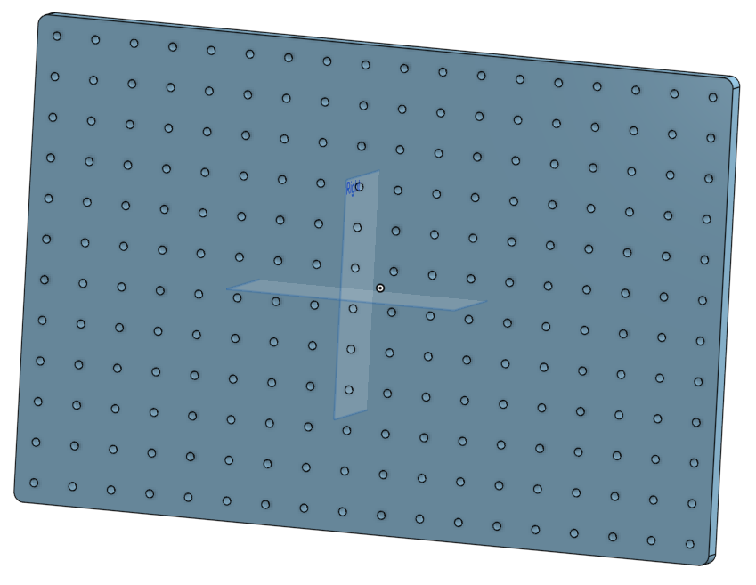
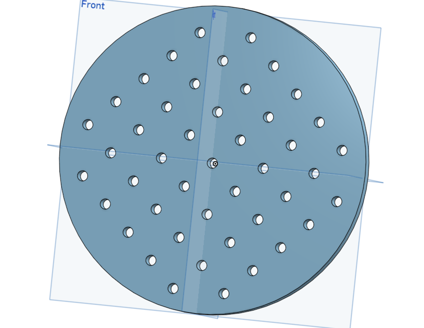

# Breadboards

Two aluminium plates form the base of a SPOUT rig: a 12 x 18 inch breadboard that carries the whole
rig, and a 6 inch round breadboard that carries the head restrained setup. Both have 1/4 20 tapped
holes on a 1 inch grid, so standard optical posts and holders fit.

  
  

## At a glance

| | |
|---|---|
| Function | Rig base plate and base for the head fixation |
| Fabrication | Machined by a machine shop from 1/2 inch aluminium plate and tapped 1/4 20 on a 1 inch grid |
| Alternative | Buy the Thorlabs equivalents (see below) |
| Used by | SPOUT1 and SPOUT2 |

## Files

All design files are in [`design/files`](design/files/) and renders in [`design/pictures`](design/pictures/).

| Part | Files | What it is | How we made it |
|---|---|---|---|
| Rig breadboard | [`.step`](design/files/breadboard_12x18.step), [`.dxf`](design/files/breadboard_12x18.dxf), [`.stl`](design/files/breadboard_12x18.stl) | 12 x 18 x 1/2 inch rig breadboard | Machine shop, 1/2 inch aluminium, holes tapped 1/4 20 |
| Round breadboard | [`.step`](design/files/breadboard_headplate.step), [`.dxf`](design/files/breadboard_headplate.dxf), [`.stl`](design/files/breadboard_headplate.stl) | 6 inch round x 1/2 inch breadboard for the head fixation | Machine shop, 1/2 inch aluminium, holes tapped 1/4 20 |

Send the STEP or DXF file to a machine shop and ask for 1/4 20 tapped holes. The STEP files are in inch; the DXF files are in mm.

## Bill of materials

| Qty | Part | Supplier | Part number | Price (USD) |
|---|---|---|---|---|
| 1 | 12 x 18 inch plate, machined | Machine shop | | |
| 1 | 6 inch round plate, machined | Machine shop | | |
| 10 | 1/4 20 screws | Thorlabs | SH25S025 | 0.55 each |

Commercial alternatives, if you prefer not to machine the plates:

| Qty | Part | Supplier | Part number | Price (USD) |
|---|---|---|---|---|
| 1 | Breadboard 12 x 18 x 1/2 inch | Thorlabs | MB1218 | 459.36 |
| 1 | Breadboard 6 inch round x 1/2 inch | Thorlabs | MBR6 | 156.35 |

Full list: [`SPOUT_BOM.xlsx`](../SPOUT_BOM.xlsx).

## Assembly

1. Screw the round breadboard on the rig breadboard and build the [head restrained setup](../head-restrained_setup/) on it.

## License
**CERN-OHL-S-2.0** ([`LICENSE`](../LICENSE)).
