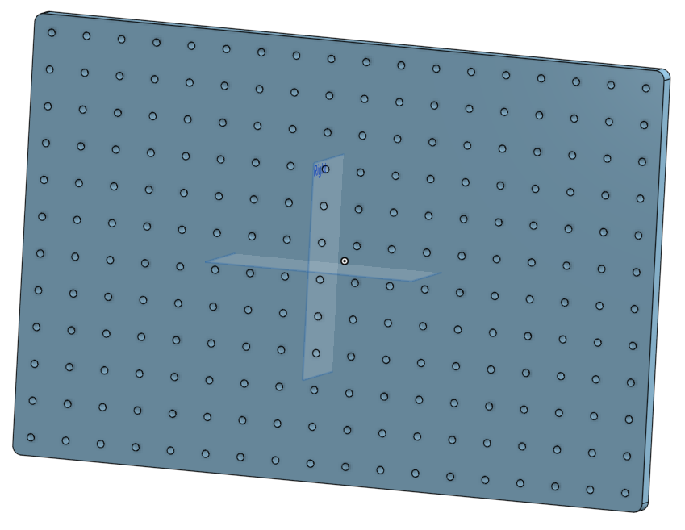
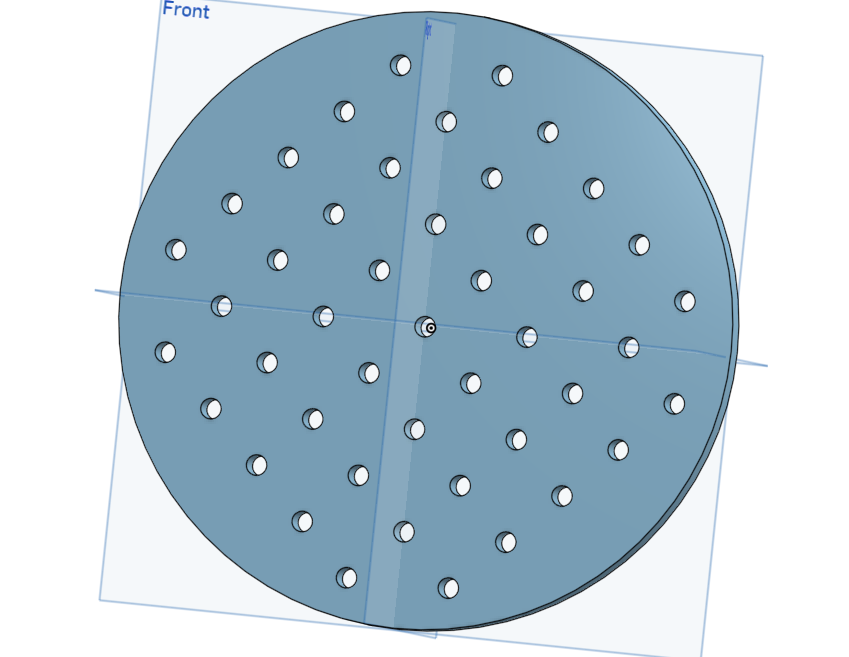

# Breadboards: design pictures

Renders of the two breadboards. Click a picture to open it at full size.

Back to the [Breadboards README](../../README.md).

<table>
<tr>
<td width="50%" align="center" valign="top"> <code>breadboard_12x18.png</code> Rig breadboard, 12 x 18 inch</td>
<td width="50%" align="center" valign="top"> <code>breadboard_headplate.png</code> Round breadboard, 6 inch, for the head fixation</td>
</tr>
</table>
