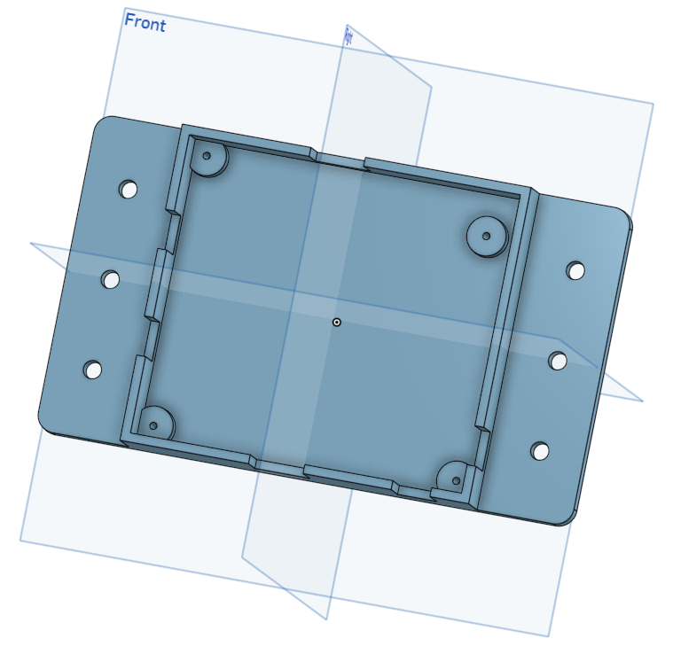

# Housing for the dual lick detector

Box that protects the lick detector board and mounts it on the breadboard.

  

| File | What it is |
|---|---|
| [`files/box_dual_lick_detector.stl`](files/box_dual_lick_detector.stl) | Housing, 152 x 89 x 20 mm, with mounting ears |

Print on any filament (FDM) 3D printer. We use a Prusa MK3 with PLA and standard settings.
Mount the board with 4-40 screws and the housing on the breadboard with 1/4 20 screws.

Back to the [dual lick detector](../README.md).
