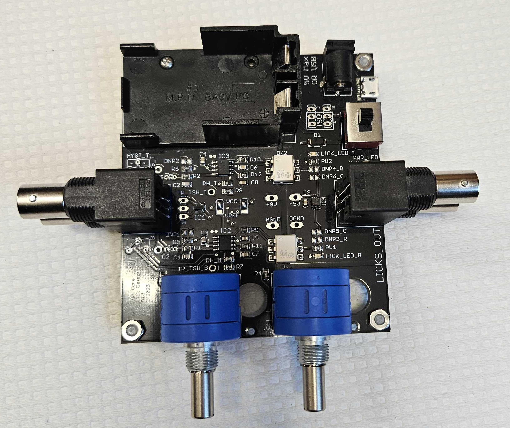
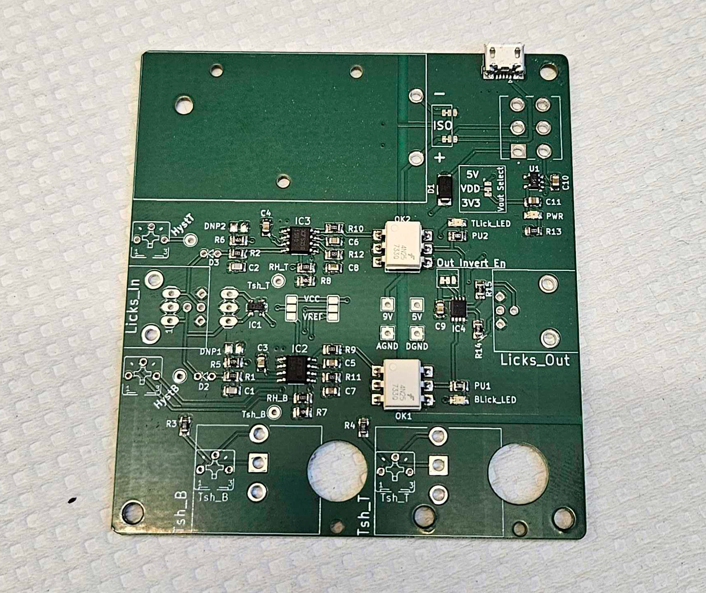
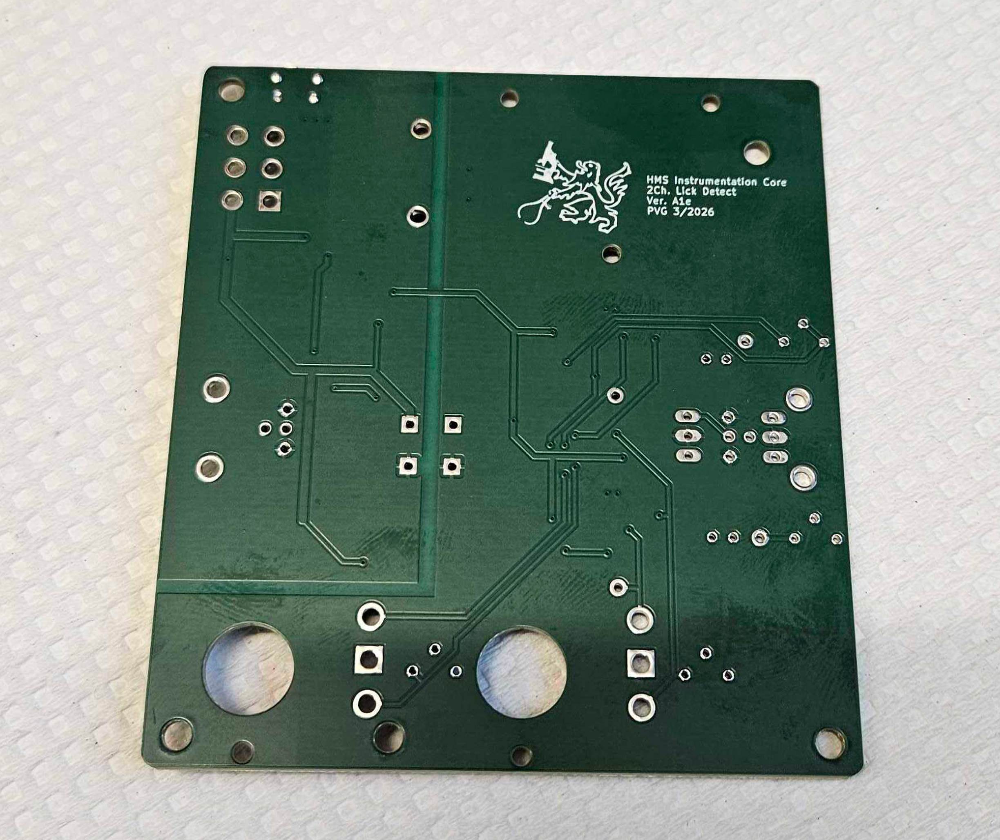
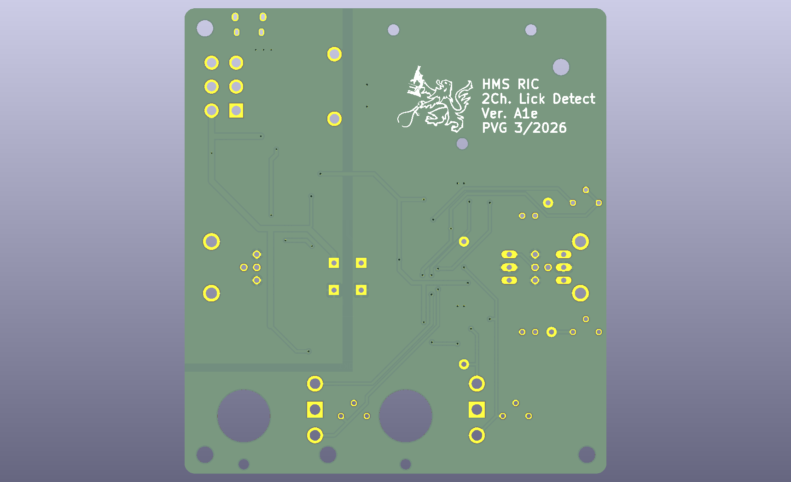
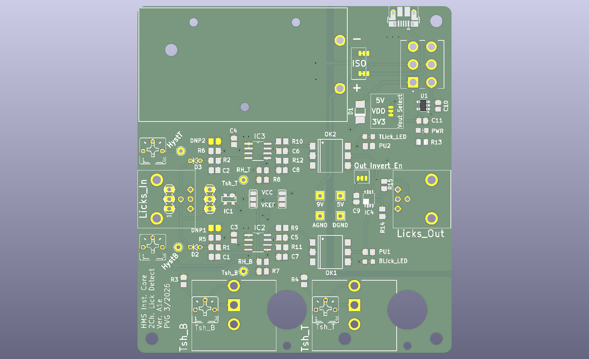

# Dual lick detector: PCB pictures

Photos and KiCad renders of the board, revision Alpha1e. Click a picture to open it at full size.

Back to the [Dual lick detector README](../../README.md).

<table>
<tr>
<td width="50%" align="center" valign="top"> <code>dual_lick_detector_1.jpg</code> Assembled board with BNC connectors, potentiometers and battery holder</td>
<td width="50%" align="center" valign="top"> <code>dual_lick_detector_2.jpg</code> Bare board, top</td>
</tr>
<tr>
<td width="50%" align="center" valign="top"> <code>dual_lick_detector_3.jpg</code> Bare board, bottom</td>
<td width="50%" align="center" valign="top"> <code>dual_lick_detector_schematic_1.png</code> KiCad render, bottom</td>
</tr>
<tr>
<td width="50%" align="center" valign="top"> <code>dual_lick_detector_schematic_2.png</code> KiCad render, top</td>
<td width="50%"></td>
</tr>
</table>
