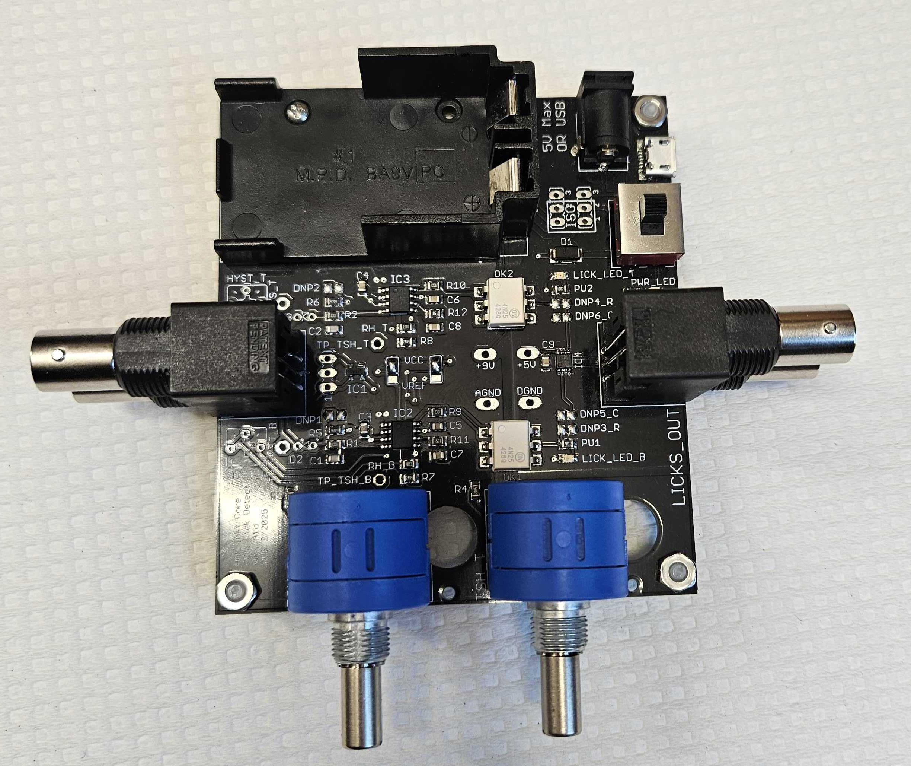
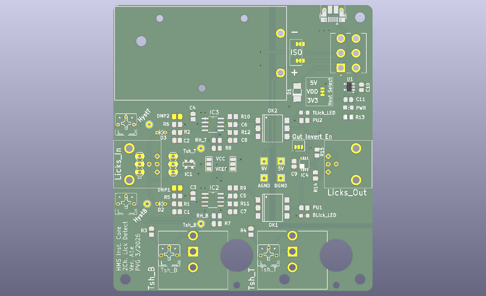

# Dual lick detector

Two channel lick detector for head restrained mice. Each lick closes a tiny current path between the
spout and the grounded mouse; the detector turns that into a clean digital pulse for the Teensy, with
sub millisecond precision.

  
  

## At a glance

| | |
|---|---|
| Function | Detects licks on one or two spouts |
| Design | Pavel Gorelik, HMS Research Instrumentation Core, revision Alpha1e (KiCad 10) |
| Fabrication | PCB with commercial assembly, 3D printed housing |
| Approximate cost | 100 USD for the assembled board |
| Used by | SPOUT1 (one channel) and SPOUT2 (two channels) |

## Key features

* Battery powered, optically isolated front end.
* Adjustable threshold and (optionally) adjustable hysteresis (100 mV default).
* Multi turn potentiometers for fine adjustment; can be fitted with a scale dial.
* Selectable conduction mode or junction potential mode. SPOUT uses conduction mode.
* Power from micro USB or a barrel jack adapter.
* Indicator LEDs for power and lick detection; ESD protected front end.
* Optional input protection diodes to support shock delivery.

## How it works in SPOUT

In conduction mode each spout is pulled up to 9 V (from a 9 V battery) through a 4.7 MOhm resistor.
When the grounded mouse touches the spout, the voltage drops and a comparator switches. The input is
filtered with a 10 us RC filter and the comparator has 100 mV hysteresis. An optically isolated output
stage, powered by a separate 3 V adapter, drives the output through a 50 Ohm source termination, so the
signal can run over BNC cables. In the SPOUT configuration the output is active low.

## Files

| File | What it is |
|---|---|
| [`PCB/files/dual_lick_detector_.kicad_sch`](PCB/files/dual_lick_detector_.kicad_sch) | Schematic (KiCad 10) |
| [`PCB/files/dual_lick_detector_.kicad_pcb`](PCB/files/dual_lick_detector_.kicad_pcb) | Board layout (KiCad 10) |
| [`ComparatorLickDet_BOM.pdf`](ComparatorLickDet_BOM.pdf) | Component list, readable version (made for revision Alpha1d) |
| [`PCB/pictures`](PCB/pictures/) | Photos and board renders, see below |

| Part | Files | What it is | How we made it |
|---|---|---|---|
| Housing | [`.stl`](design/files/box_dual_lick_detector.stl), [`.step`](design/files/box_dual_lick_detector.step) | Housing, 152 x 89 x 20 mm, with mounting ears | 3D printed, PLA |

The SPOUT paper used revision Alpha1d (EAGLE). Alpha1e is the KiCad version of that design.
Newer revisions are developed in the [HMS RIC repository](https://github.com/HMS-RIC/2-Channel-Lick-Detector).

### Pictures

| Picture | What it shows |
|---|---|
| [`dual_lick_detector_1.jpg`](PCB/pictures/dual_lick_detector_1.jpg) | Assembled board with BNC connectors, potentiometers and battery holder |
| [`dual_lick_detector_2.jpg`](PCB/pictures/dual_lick_detector_2.jpg) | Bare board, top |
| [`dual_lick_detector_3.jpg`](PCB/pictures/dual_lick_detector_3.jpg) | Bare board, bottom |
| [`dual_lick_detector_schematic_1.png`](PCB/pictures/dual_lick_detector_schematic_1.png) | Board render from KiCad, bottom |
| [`dual_lick_detector_schematic_2.png`](PCB/pictures/dual_lick_detector_schematic_2.png) | Board render from KiCad, top |

## Bill of materials

| Qty | Part | Supplier | Part number | Price (USD) |
|---|---|---|---|---|
| 1 | Assembled lick detector board | Any PCB assembler (we used PCBWay) | KiCad files | 100 |
| 1 | 3D printed housing | | | |
| 1 | 9 V battery | | | |
| 1 | Power adapter 3 V (output stage) | NC | BY0301&BK | 5.57 |
| 1 | Stainless steel tube for the spouts | McMaster-Carr | 5560K72 | 3.90 |
| 1 | Banana socket and plug (mouse ground) | | | 2.98 |

Full list: [`SPOUT_BOM.xlsx`](../SPOUT_BOM.xlsx).

## Ordering the PCB

The board is designed in KiCad 10. Open the `.kicad_pcb` file in KiCad (free, [kicad.org](https://www.kicad.org)) and export
what your fabricator needs: Gerber and drill files (File, Fabrication Outputs), and for commercial assembly the
component list and the position file from the same menu. Default manufacturing settings are fine.

## Fabrication

1. Order the assembled board as described above. The SPOUT boards were made and assembled by PCBWay.
2. Print `box_dual_lick_detector.stl` on a Prusa MK3 in PLA with standard settings. Mount the board with 4-40 screws and the housing on the breadboard with 1/4 20 screws.

## Assembly

1. Mount the board in the housing and the housing on the breadboard.
2. Connect the spouts to the inputs, and the outputs to the Teensy breakout board, as listed below.
3. Ground the mouse: connect the detector ground to the aluminium tube of the head restrained setup with the banana plug and socket.
4. Insert the 9 V battery and connect the 3 V adapter.
5. For imaging, split the lick outputs with a BNC T connector to your DAQ as well.

## Connections

Seen from the top, with the potentiometers facing up. Each side has two BNC connectors, one above the other.

| Part | SPOUT2 (two spouts) | SPOUT1 (one spout) |
|---|---|---|
| Left BNC, top | Left lick output, to PIN14_A0 on the Teensy breakout board | Lick output, to PIN14_A0 |
| Left BNC, bottom | Right lick output, to PIN41_A17 | Not used |
| Right BNC, top | Left lick input, from the left spout | Lick input, from the spout |
| Right BNC, bottom | Right lick input, from the right spout | Not used |
| Bottom LED | Left lick detected | Lick detected |
| Top LED | Right lick detected | Not used |
| Left potentiometer | Left lick threshold | Lick threshold |
| Right potentiometer | Right lick threshold | Not used |

## Testing and calibration

1. Touch a spout with one hand while touching the ground (aluminium tube) with the other: the lick LED lights up and the GUI shows the lick.
2. Set the threshold with the multi turn potentiometer (left for the left spout, right for the right spout) so a touch is detected reliably while the idle spout stays silent. Set it per rig, because cable length and grounding differ.

## License and attribution
Designed and developed by the [HMS Research Instrumentation Core](https://github.com/HMS-RIC), whose
members are authors of SPOUT, and shared here as part of SPOUT under **CERN-OHL-S-2.0**
([`LICENSE`](../LICENSE)). Newer revisions are developed in the
[HMS RIC repository](https://github.com/HMS-RIC/2-Channel-Lick-Detector).
