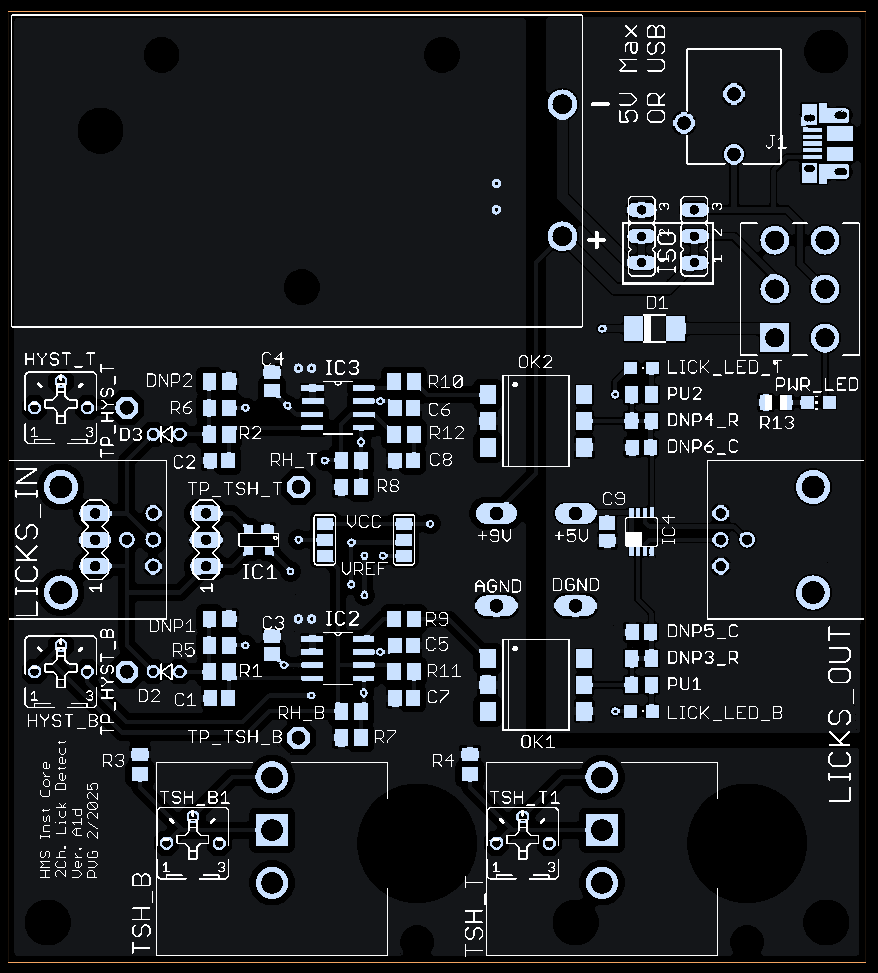
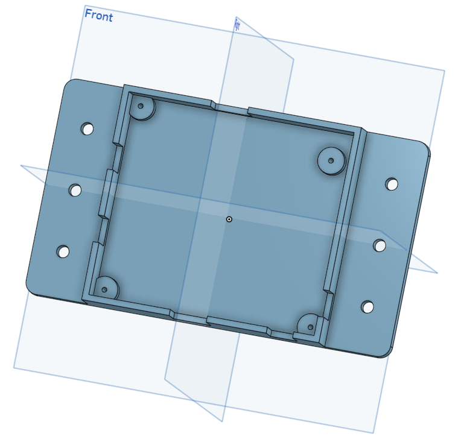

# Dual-lick detector (2-channel)

> **Attribution.** The **Harvard Medical School (HMS)
> Research Instrumentation Core** actively develops the dual lick detector.
> The version in this repo is actively used in lab and was used in the manuscript.
> It is **not** covered by SPOUT's CERN-OHL-S license and retains its own
> upstream license and terms.
>
> **Upstream repository (check here for newer board revisions):**
> https://github.com/HMS-RIC/2-Channel-Lick-Detector

2-channel lick detector for rodent behavior experiments.

## Key features
- Battery-powered, optically-isolated front end.
- Adjustable threshold and (optionally) adjustable hysteresis (100 mV default).
- Multi-turn potentiometers for fine adjustment; can be installed with a scale dial.
- Selectable "conduction mode" or "junction potential mode".
- Power from micro-USB or barrel-jack adapter.
- Indicator LEDs for power and lick detection; ESD-protected front end.
- Optional input protection diodes to support shock delivery.

## PCB fabrication
The full fabrication design is in the Gerber files under [`PCB/Alpha1d/`](PCB/Alpha1d/)
(`ComparatorLickDet_Alpha1d.zip`). Upload the zip to any PCB fabricator for a quote. The
board uses no special features, so default manufacturing settings are typically fine.
For commercial assembly you'll also need the centroid file
(`ComparatorLickDetCentroid_Alpha1d.txt`) and the BOM
(`HMS-2-Ch-Lick-Detector-Alpha1d_BOM_PCBWay.xlsx`). Initial fabrication/assembly for this
project was done via PCBWay.

## Connecting to lick spouts
Connect one or two lick spouts (22 gauge stainless-steel tubing is common) via BNC
connectors soldered to the PCB, or by soldering hobby-servo wire in place of the BNC
connector.

## Housing for dual-lick detector
Housing can be 3D printed on most fused deposition modeling (i.e., melt plastic filament layer by layer). We use the Prusa MK3.

<i>Picture of the dual-lick detector housing</i>

  

## Files
- `PCB/Alpha1d/` — current revision: board, schematic, Gerber zip, centroid, BOM, renders.
- `PCB/Alpha1b/` — earlier revision (board + schematic).
- `Photos/` — board photographs.
- `ComparatorLickDet_BOM.pdf` — bill of materials.

*See the upstream repository above for the authoritative, most up-to-date version.*
