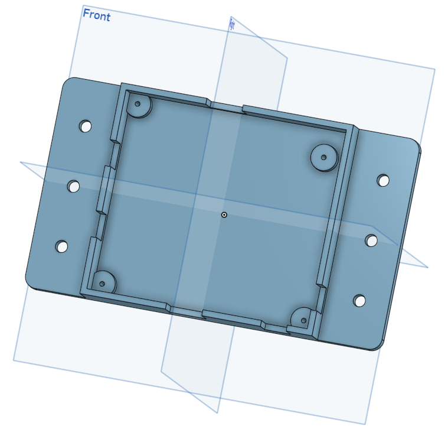

# Dual lick detector: design pictures

Render of the 3D printed housing. Click a picture to open it at full size.

Back to the [Dual lick detector README](../../README.md).

<table>
<tr>
<td width="50%" align="center" valign="top"> <code>box_dual_lick_detector.png</code> Housing, 152 x 89 x 20 mm</td>
<td width="50%"></td>
</tr>
</table>
