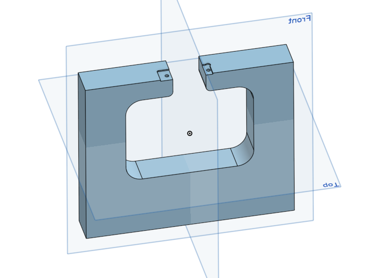
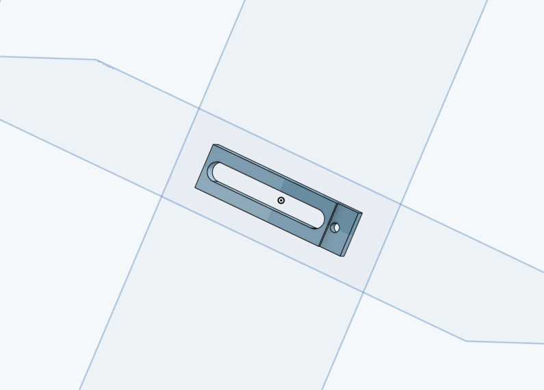

# Head restrained setup

Headplates and holders that keep the mouse's head still during behavior, optogenetics and two photon
imaging. The headplates are laser cut from titanium; the holders, ramps and imaging cone are machined
from aluminium (3D printing also works for the holders and ramps).

  
  

## At a glance

| | |
|---|---|
| Function | Head fixation for behavior (small plate) and for two photon imaging (plate with window opening) |
| Fabrication | Headplates: laser cut grade 5 titanium. Holders, ramps, cone: machined aluminium; holders and ramps can also be 3D printed |
| Approximate cost | Headplates 1.40 to 1.61 USD each, cone 4.50 USD, mounting hardware about 280 USD |
| Used by | SPOUT1 and SPOUT2 |

## The parts

| Part | Purpose |
|---|---|
| Behavior headplate | Small plate that leaves the skull free for optical fibers and other implants |
| Behavior holders, left and right | Clamp the behavior headplate |
| Behavior 15 degree ramp (right) | Levels the head of mice implanted at an angle. Only a right ramp exists, because a left one is too small to be practical |
| Imaging headplate | Plate with a central opening for a cranial window or GRIN lens; three small magnets are pressed into it |
| Imaging holder | Large U shaped holder for the imaging headplate |
| Imaging 15 degree ramps, left and right | Level the head of mice implanted at an angle for lateral imaging, so straight and angled mice train on the same rig |
| Imaging cone | Sits on the imaging headplate with three magnets and holds water for the objective. Seal with a thin layer of silicone (Picodent Eco sil speed) |
| Imaging cover | Snaps on magnetically to protect the window between sessions. Add silicone if the mouse removes it |

## Files

| File | What it is | How to make it |
|---|---|---|
| [`headplate_behavior.dxf`](cnc/files/headplate_behavior.dxf) | Behavior headplate, 27.5 x 10.4 mm | Laser cut, titanium 0.04 inch (1 mm) |
| [`headplate_2pimaging.dxf`](cnc/files/headplate_2pimaging.dxf) | Imaging headplate, 27.5 x 23.8 mm | Laser cut, titanium 0.04 inch |
| [`headplate_2pimaging_cover.dxf`](cnc/files/headplate_2pimaging_cover.dxf) | Imaging cover | Laser cut |
| [`headplate_behavior_holder_left.stl`](cnc/files/headplate_behavior_holder_left.stl), [`right`](cnc/files/headplate_behavior_holder_right.stl) | Behavior holders | Machined aluminium or 3D printed |
| [`headplate_behavior_15degreesramp_right.stl`](cnc/files/headplate_behavior_15degreesramp_right.stl) | Behavior ramp | Machined aluminium or 3D printed |
| [`headplate_2pimaging_holder_big.stl`](cnc/files/headplate_2pimaging_holder_big.stl) | Imaging holder | Machined aluminium or 3D printed |
| [`headplate_2pimaging_15degreesramp_left.stl`](cnc/files/headplate_2pimaging_15degreesramp_left.stl), [`right`](cnc/files/headplate_2pimaging_15degreesramp_right.stl) | Imaging ramps | Machined aluminium or 3D printed |
| [`headplate_2pimaging_cone.stl`](cnc/files/headplate_2pimaging_cone.stl) | Imaging cone | Machined aluminium 6061 |
| `.stl` versions of the headplates and cover | 3D views | |
| [`cnc/pictures`](cnc/pictures/) | Renders of every part | |

DXF files are in mm.

## Bill of materials

| Qty | Part | Supplier | Part number | Price (USD) |
|---|---|---|---|---|
| 1 | Behavior headplate | SendCutSend | Titanium | 1.40 |
| 1 | Imaging headplate | SendCutSend | Titanium | 1.61 |
| 1 | Imaging cone | eMachineShop | Aluminium 6061 | 4.50 |
| 3 | Magnets for the headplate, 1/16 x 1/32 inch | K&J Magnetics | | 0.14 each |
| 3 | Magnets for the cone, 2 x 0.5 mm | The Magnet Baron | | 0.15 each |
| 2 | Headplate holders | Machined in house | | |
| 1 | Kinematic magnetic base | Newport | BK-3A | 159.64 |
| 1 | Pedestal post holder | Thorlabs | PH1 | 8.74 |
| 1 | Optical post | Thorlabs | TR6 | 8.66 |
| 1 | Adjustable height optics clamp | Thorlabs | VG100 | 93.34 |
| 1 | Aluminium tube (body tube, also the mouse ground) | McMaster-Carr | 6061 | 6.75 |
| 1 | Banana socket | | | 1.28 |
| 1 | Round breadboard | see [`breadboards`](../breadboards/) | | |

Full list: [`SPOUT_BOM.xlsx`](../SPOUT_BOM.xlsx).

## Assembly

1. Mount the round breadboard on the rig breadboard.
2. Build the head fixation post: kinematic magnetic base, pedestal post holder, optical post and optics clamp.
3. Mount the headplate holders (with a ramp if needed) on the head fixation post with 4-40 screws.
4. Place the aluminium tube for the mouse body and connect it to the lick detector ground with the banana socket.
5. Press the magnets into the imaging headplate and the cone.

Photos of the build process will be added. Surgery and headplate implantation are described in the
Methods of the [SPOUT paper](https://www.biorxiv.org/content/10.64898/2026.08.21.746318v2).

## License
**CERN-OHL-S-2.0** ([`LICENSE`](../LICENSE)).
