# Head restrained setup: design pictures

Photos and renders of the headplates, holders, ramps, cone and cover. Click a picture to open it at full size.

Back to the [Head restrained setup README](../../README.md).

## Photos

<table>
<tr>
<td width="50%" align="center" valign="top"><a href="head-restriction_setup_side.png">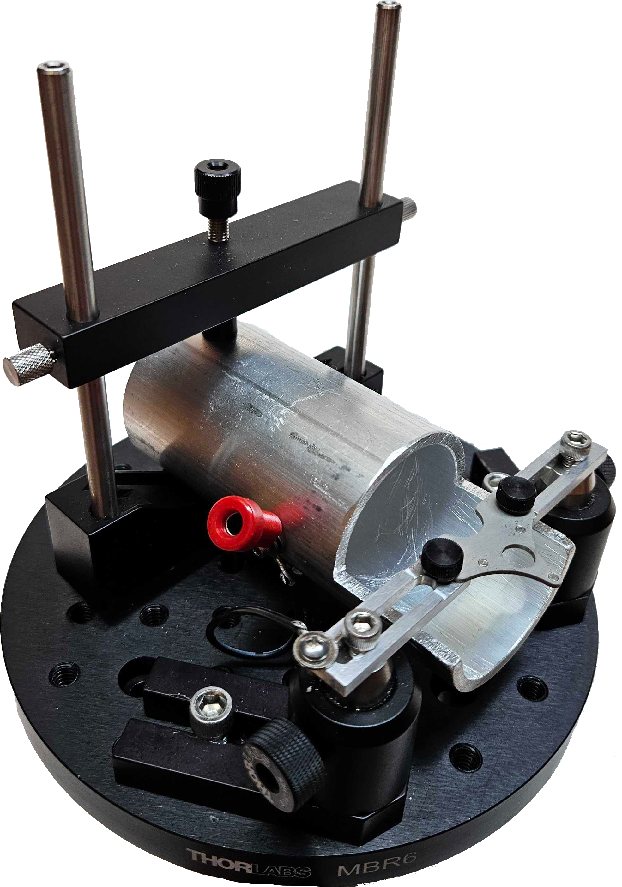</a> <code>head-restriction_setup_side.png</code> Head restrained setup, side view</td>
<td width="50%" align="center" valign="top"><a href="head-restriction_setup_top.png">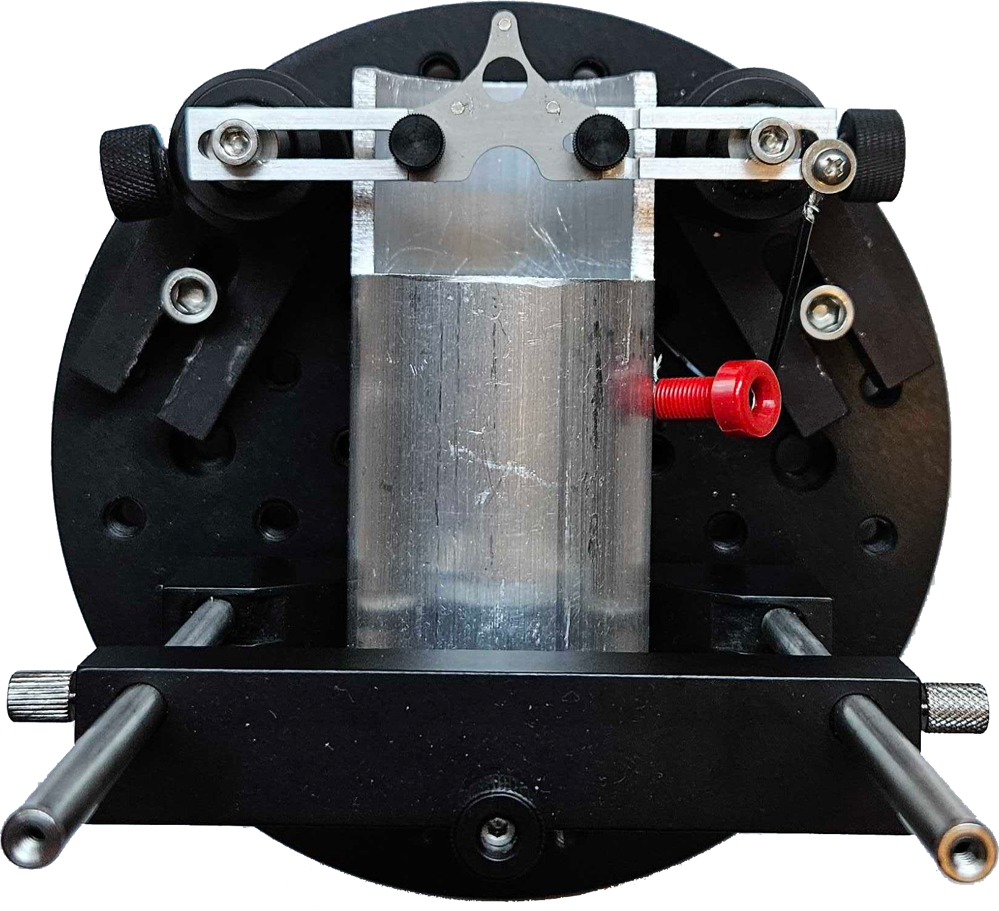</a> <code>head-restriction_setup_top.png</code> Head restrained setup, top view</td>
</tr>
<tr>
<td width="50%" align="center" valign="top"><a href="head-restriction_setup_imaging.png">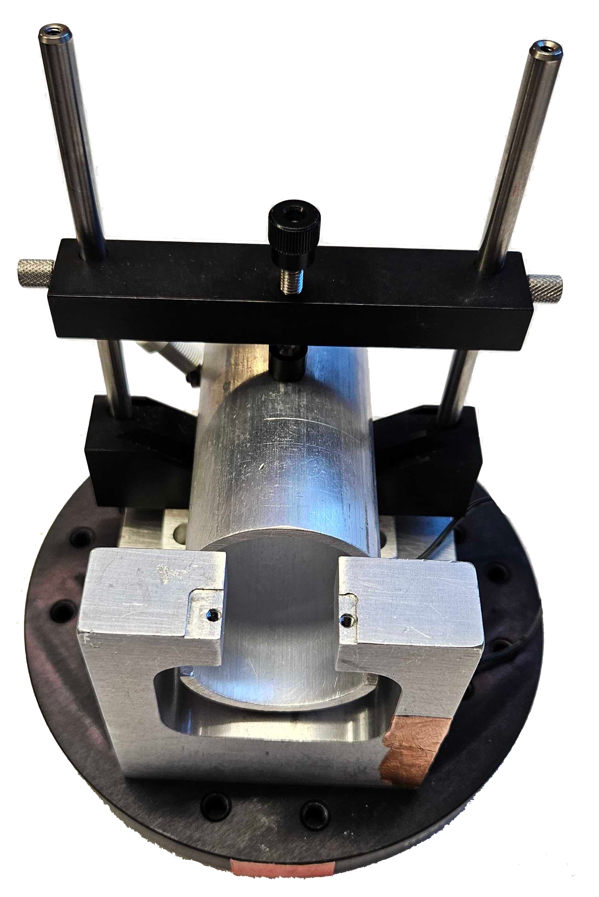</a> <code>head-restriction_setup_imaging.png</code> Head restrained setup with the imaging holder</td>
<td width="50%" align="center" valign="top"><a href="headplate_behavior_photo.png">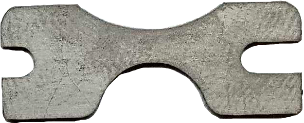</a> <code>headplate_behavior_photo.png</code> Behavior headplate, titanium</td>
</tr>
<tr>
<td width="50%" align="center" valign="top"><a href="headplate_2pimaging_photo.png">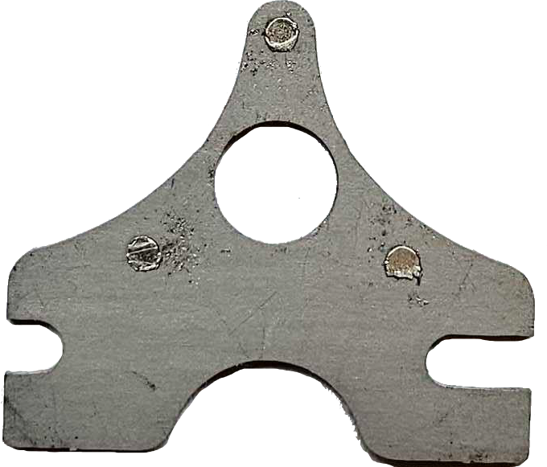</a> <code>headplate_2pimaging_photo.png</code> Imaging headplate, titanium, with three magnets</td>
<td width="50%" align="center" valign="top"><a href="headplate_2pimaging_cone_photo.png">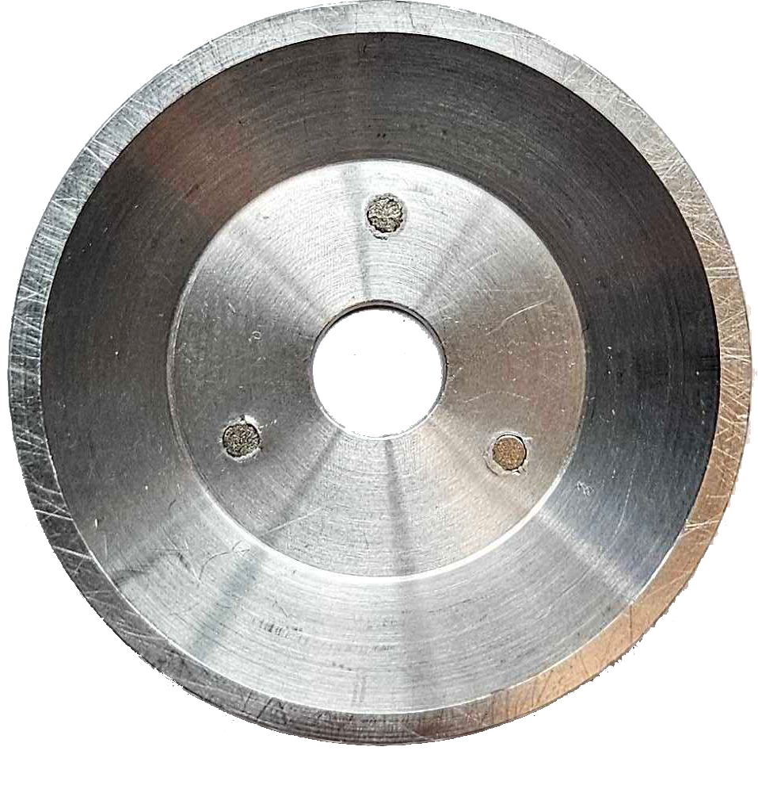</a> <code>headplate_2pimaging_cone_photo.png</code> Imaging cone, aluminium, with three magnets</td>
</tr>
</table>

## Renders

<table>
<tr>
<td width="50%" align="center" valign="top"><a href="headplate_2pimaging.png">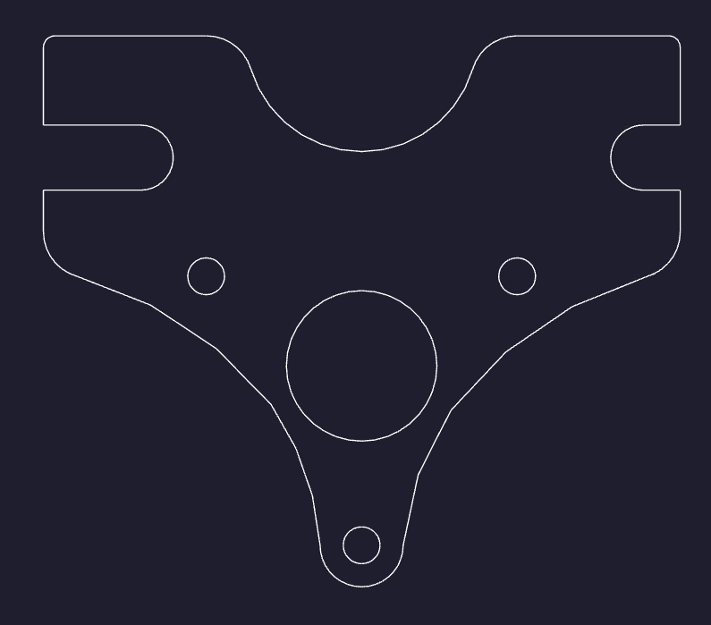</a> <code>headplate_2pimaging.png</code> Imaging headplate</td>
<td width="50%" align="center" valign="top"><a href="headplate_2pimaging_15degreesramp_left.png">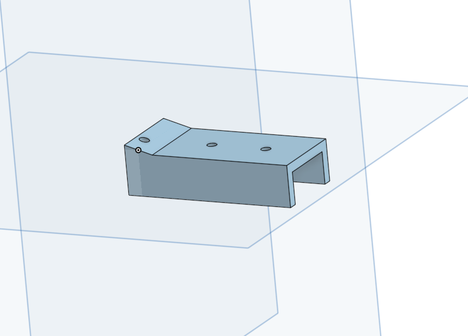</a> <code>headplate_2pimaging_15degreesramp_left.png</code> Imaging ramp, 15 degrees, left</td>
</tr>
<tr>
<td width="50%" align="center" valign="top"><a href="headplate_2pimaging_15degreesramp_right.png">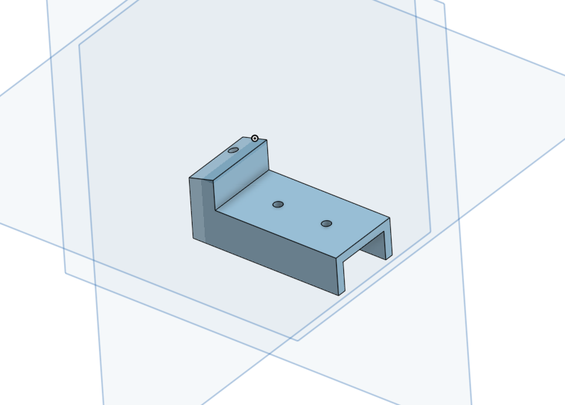</a> <code>headplate_2pimaging_15degreesramp_right.png</code> Imaging ramp, 15 degrees, right</td>
<td width="50%" align="center" valign="top"><a href="headplate_2pimaging_cone.png">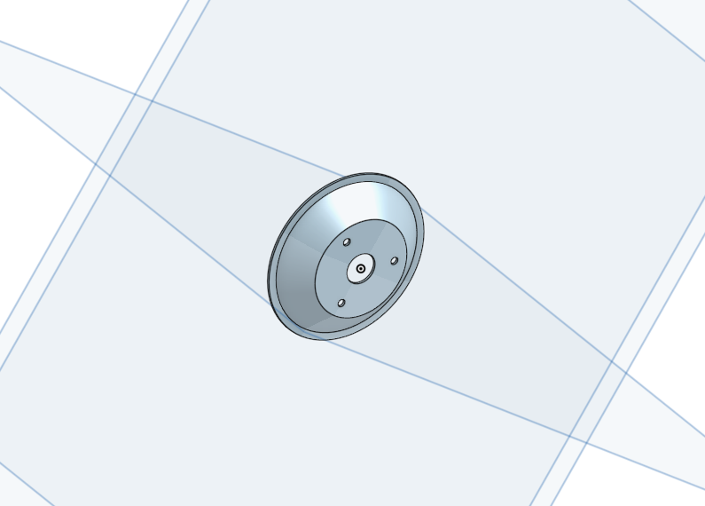</a> <code>headplate_2pimaging_cone.png</code> Imaging cone</td>
</tr>
<tr>
<td width="50%" align="center" valign="top"><a href="headplate_2pimaging_cover.png">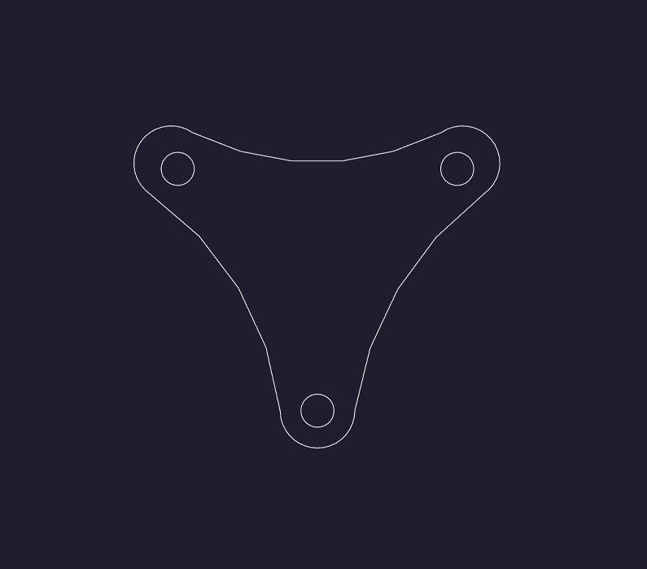</a> <code>headplate_2pimaging_cover.png</code> Imaging cover</td>
<td width="50%" align="center" valign="top"><a href="headplate_2pimaging_holder_big1.png">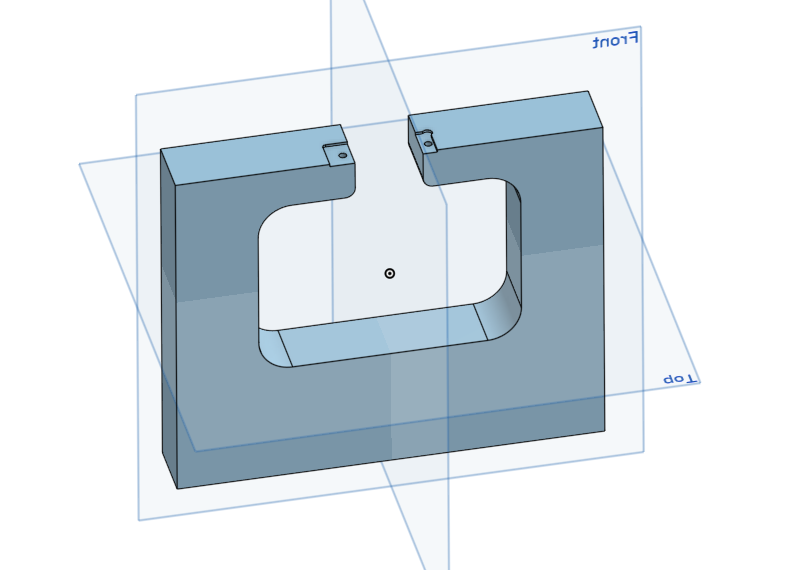</a> <code>headplate_2pimaging_holder_big1.png</code> Imaging holder, view 1</td>
</tr>
<tr>
<td width="50%" align="center" valign="top"><a href="headplate_2pimaging_holder_big2.png">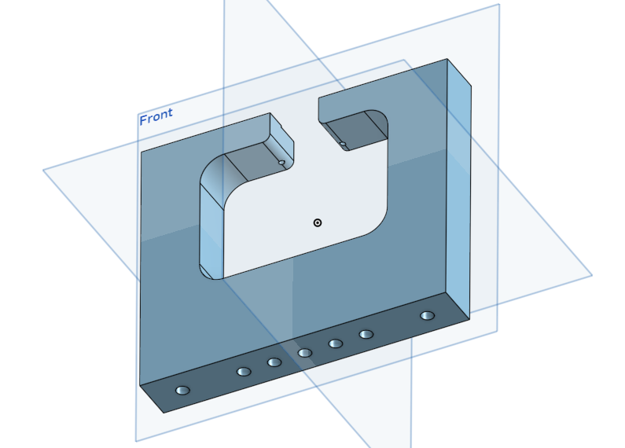</a> <code>headplate_2pimaging_holder_big2.png</code> Imaging holder, view 2</td>
<td width="50%" align="center" valign="top"><a href="headplate_behavior.png">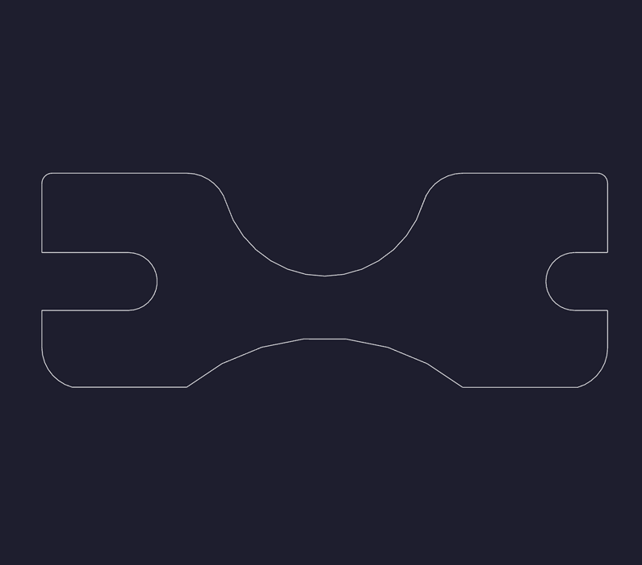</a> <code>headplate_behavior.png</code> Behavior headplate</td>
</tr>
<tr>
<td width="50%" align="center" valign="top"><a href="headplate_behavior_15degreesramp_right.png">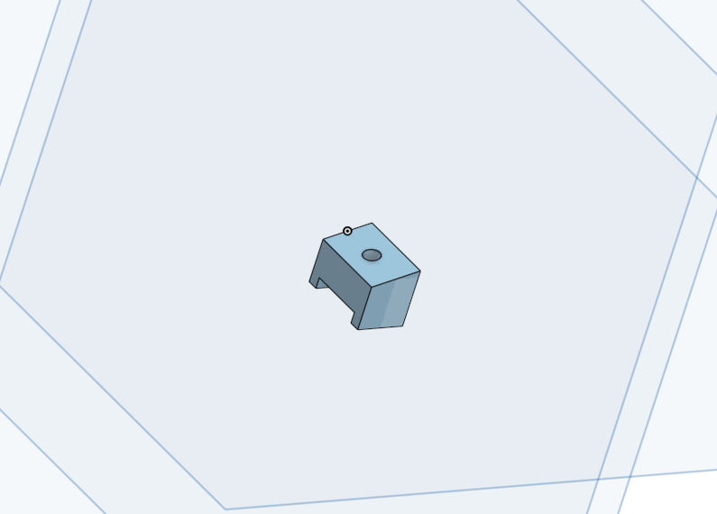</a> <code>headplate_behavior_15degreesramp_right.png</code> Behavior ramp, 15 degrees, right</td>
<td width="50%" align="center" valign="top"><a href="headplate_behavior_holder_left.png">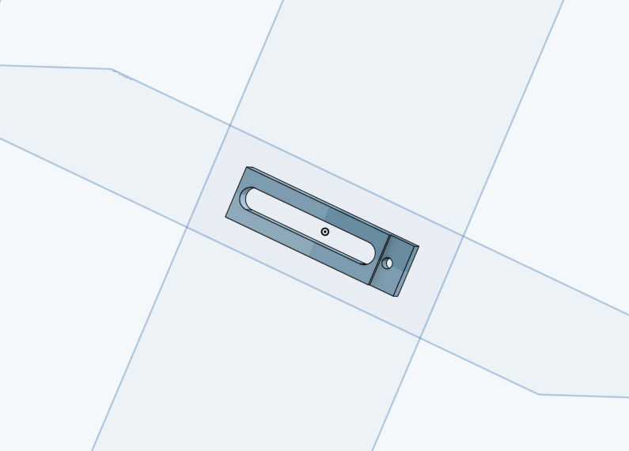</a> <code>headplate_behavior_holder_left.png</code> Behavior holder, left</td>
</tr>
<tr>
<td width="50%" align="center" valign="top"><a href="headplate_behavior_holder_right.png">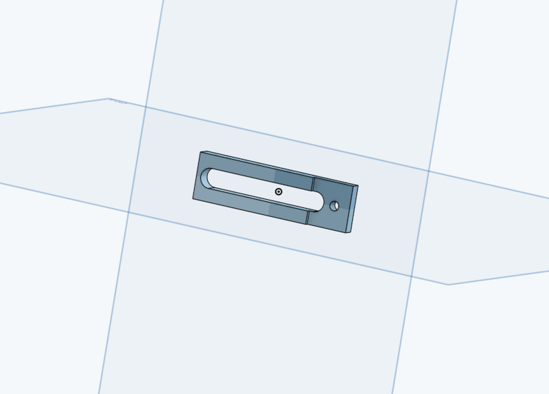</a> <code>headplate_behavior_holder_right.png</code> Behavior holder, right</td>
<td width="50%"></td>
</tr>
</table>
