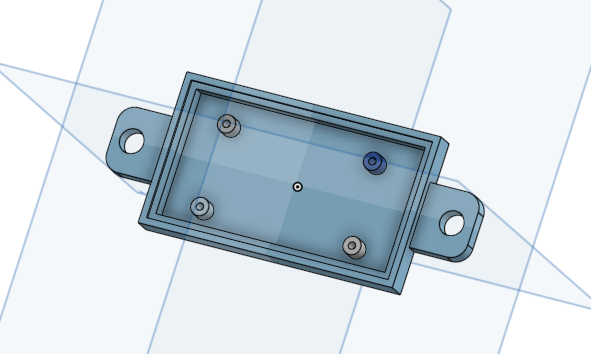
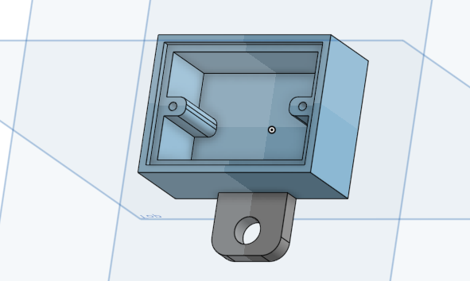

# Miscellaneous housings

3D printed boxes for the smaller electronics of a SPOUT rig.

  
  

## Files

| File | What it is |
|---|---|
| [`box_drok_amplifier.stl`](3d_printing/files/box_drok_amplifier.stl) | Housing for the DROK audio amplifier that drives the two speakers, 115 x 47 x 8 mm |
| [`box_power_small_sparkfun_breadboard.stl`](3d_printing/files/box_power_small_sparkfun_breadboard.stl) | Housing for a SparkFun Solderable Breadboard Mini. Used for the power distribution breadboard (3, 5 and 12 V); the same box houses the [optogenetics power modulator](../optogenetics_power_modulator/) |
| [`3d_printing/pictures`](3d_printing/pictures/) | Renders |

Print on a Prusa MK3 in PLA with standard settings.

## Bill of materials

**Sound**

| Qty | Part | Supplier | Part number | Price (USD) |
|---|---|---|---|---|
| 1 | Audio amplifier, 15 W x 15 W | DROK | | 10.75 |
| 2 | Speaker | Intervox | S150RMSS-R2W | 0.75 each |
| 1 | L bracket | McMaster-Carr | 1556A54 | 1.06 |
| 2 | Optical post | Thorlabs | TR3 | 6.58 each |
| 1 | 3D printed amplifier housing | | | |

**Power**

| Qty | Part | Supplier | Part number | Price (USD) |
|---|---|---|---|---|
| 1 | Power adapter 3 V (lick detector output stage) | NC | BY0301&BK | 5.57 |
| 1 | Power adapter 5 V (solenoids) | MTYTOT | ALT-0503 | 6.99 |
| 1 | Power adapter 12 V (audio amplifier) | SmoTecQ | STQ-12V-2A | 5.95 |
| 1 | 3D printed power box | | | |

Full list: [`SPOUT_BOM.xlsx`](../SPOUT_BOM.xlsx).

## Connecting to SPOUT

* The amplifier inputs take the speaker outputs of the Teensy breakout board (pins 2 and 15). The speakers sit on short posts with the L bracket.
* The power box distributes the adapter voltages to the lick detector, the solenoid drivers and the amplifier.

## License
**CERN-OHL-S-2.0** ([`LICENSE`](../LICENSE)).
