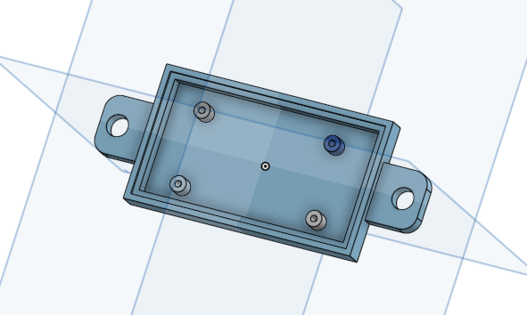
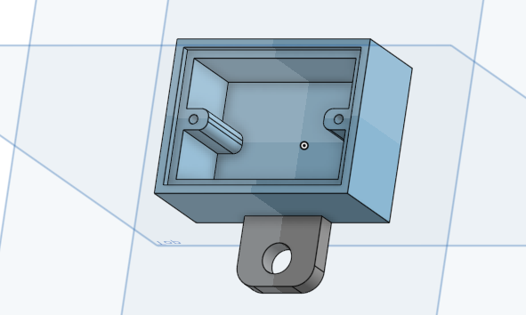

# Miscellaneous housings: design pictures

Renders of the 3D printed housings. Click a picture to open it at full size.

Back to the [Miscellaneous housings README](../../README.md).

<table>
<tr>
<td width="50%" align="center" valign="top"> <code>box_drok_amplifier.png</code> Housing for the DROK audio amplifier</td>
<td width="50%" align="center" valign="top"> <code>box_power_small_sparkfun_breadboard.png</code> Power box for a SparkFun Solderable Breadboard Mini</td>
</tr>
</table>
