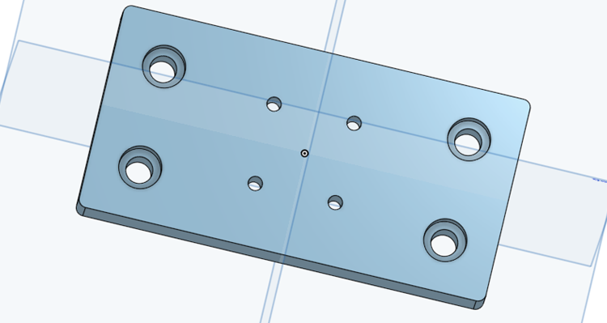
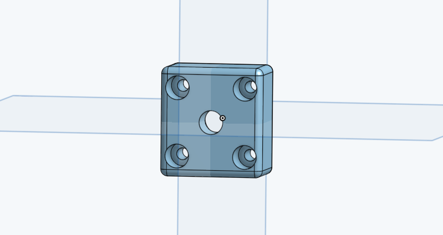

# Motorized manipulator

Three motorized linear stages stacked into an X, Y, Z manipulator that positions the lick spouts in
front of the mouse. Each stage has its own stepper motor driver and controller, so spouts can be moved
precisely and returned to the same position every session.

  
  

## At a glance

| | |
|---|---|
| Function | Three axis positioning of the spout holder |
| Fabrication | Bought linear stages and drivers, 3D printed adapters, laser cut driver box |
| Control | Manually from the controller display, or by TTL input to the drivers |
| Approximate cost | 240 USD |
| Used by | SPOUT1 and SPOUT2 |

The drivers accept TTL control, so the stages can be moved by a microcontroller or a computer.
The SPOUT firmware does not move the stages; in SPOUT they are positioned manually.

## Files

| File | What it is | How to make it |
|---|---|---|
| [`micromanipulator_to_breadboard.stl`](3d_printing/files/micromanipulator_to_breadboard.stl) | Plate (4 x 2 inch) that mounts the bottom stage on the breadboard | 3D print |
| [`micromanipulator_stage2postHalfInch.stl`](3d_printing/files/micromanipulator_stage2postHalfInch.stl) | Adapter from the top stage to a 1/2 inch post | 3D print |
| [`micromanipulator_stage2postQuarterInch.stl`](3d_printing/files/micromanipulator_stage2postQuarterInch.stl) | Adapter from the top stage to a 1/4 inch post | 3D print |
| [`template_linear_track_holes-5cm.stl`](laser_cutting/files/template_linear_track_holes-5cm.stl), [`10cm`](laser_cutting/files/template_linear_track_holes-10cm.stl) | Drilling templates (1 mm) to mount one stage on the carriage of another | Laser cut |
| [`template_linear_track_holes-edge.stl`](laser_cutting/files/template_linear_track_holes-edge.stl) | Drilling template (30 x 28 x 1 mm) for the end plate of a stage | Laser cut |
| [`box_mounting_steppermotor_drivers.pdf`](laser_cutting/files/box_mounting_steppermotor_drivers.pdf), [`.ai`](laser_cutting/files/box_mounting_steppermotor_drivers.ai) | Box for the three drivers | Laser cut, 0.125 inch acrylic |
| [`3d_printing/pictures`](3d_printing/pictures/), [`laser_cutting/pictures`](laser_cutting/pictures/) | Renders | |

3D printed parts: Prusa MK3, PLA, standard settings.

## Bill of materials

| Qty | Part | Supplier | Part number | Price (USD) |
|---|---|---|---|---|
| 3 | Linear stage with NEMA 11 stepper motor (50 mm) | Befenybay | BE073-1 | 47.30 each |
| 3 | Stepper motor driver and controller | Banria | 4257 | 26.90 each |
| 1 | Power supply 24 V | DROK | | 15.89 |
| 1 | Laser cut driver box | | | |
| 1 | 3D printed adapter to breadboard | | | |
| 1 | 3D printed adapter to post | | | |

Full list: [`SPOUT_BOM.xlsx`](../SPOUT_BOM.xlsx).

## Assembly

1. Print the adapters, and laser cut the driver box and the drilling templates.
2. Screw the bottom stage on `micromanipulator_to_breadboard` and mount it on the breadboard with 1/4 20 screws.
3. Use the drilling templates to mark and drill the holes that mount the stages on each other, giving the X, Y and Z axes.
4. Mount `micromanipulator_stage2post` on the top carriage and put an optical post with the [spout holder](../spout_holder/) in it.
5. Wire each motor to its driver. Motor leads: black A+, green A minus, red B+, blue B minus (check the label on your motor). Driver terminals: A+, A minus, B minus, B+.
6. Connect the 24 V supply to VCC and GND of each driver, and mount the three drivers in the laser cut box.

Photos of the build process will be added.

## Use

* Move an axis with the CW and CCW buttons; set the speed with the knob.
* Set the microstep resolution and motor current on the driver board (DIP switch and current potentiometer).
* For TTL control, connect the CW, CCW and STOP inputs on the driver header to your controller.

## License
**CERN-OHL-S-2.0** ([`LICENSE`](../LICENSE)) for the printed and laser cut parts. The stages and drivers are commercial products.
