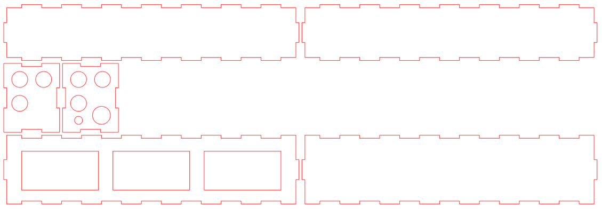
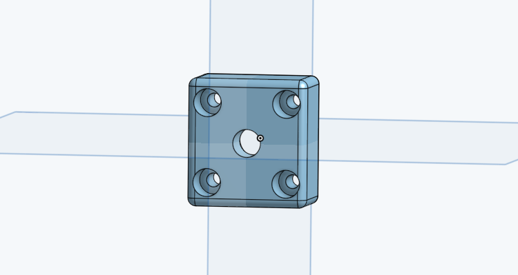
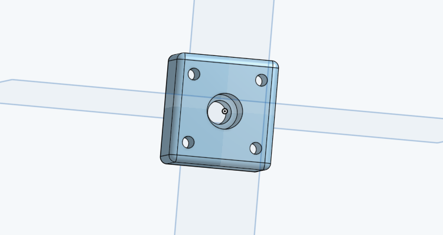
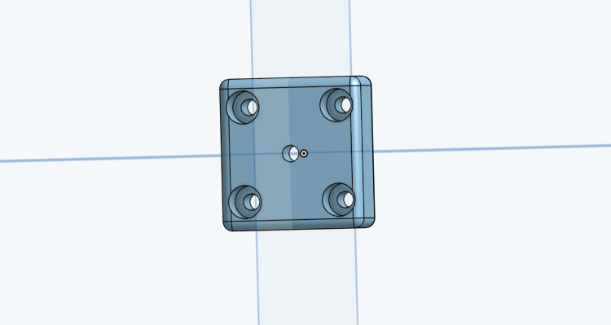
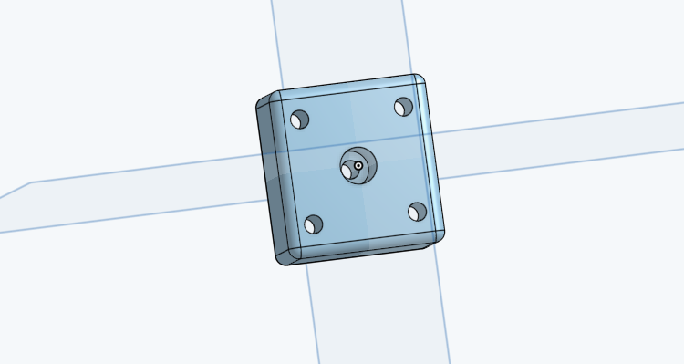
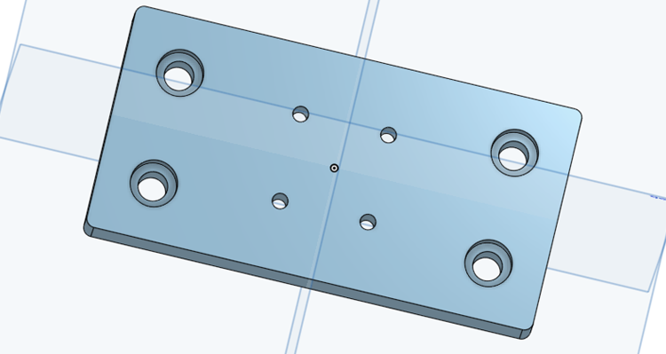
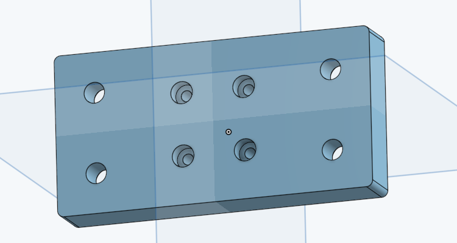
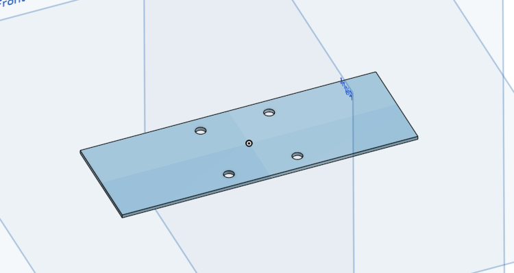
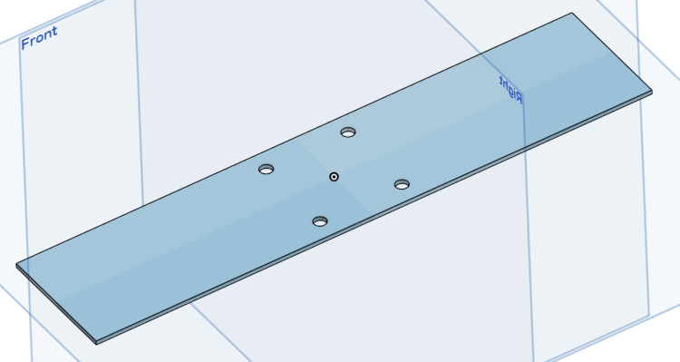
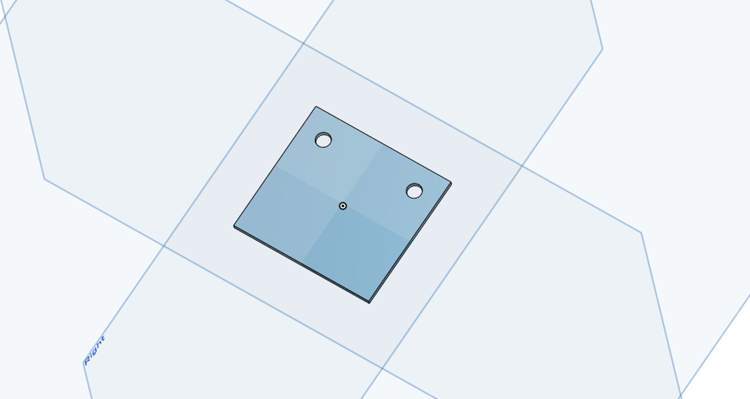

# Motorized manipulator: design pictures

Renders of the 3D printed adapters, the drilling templates and the laser cut driver box. Click a picture to open it at full size.

Back to the [Motorized manipulator README](../../README.md).

<table>
<tr>
<td width="50%" align="center" valign="top"> <code>box_mounting_steppermotor_drivers.png</code> Laser cut box for the three drivers, cutting layout</td>
<td width="50%" align="center" valign="top"> <code>micromanipulator_stage2postHalfInch1.png</code> Adapter from the top stage to a 1/2 inch post, view 1</td>
</tr>
<tr>
<td width="50%" align="center" valign="top"> <code>micromanipulator_stage2postHalfInch2.png</code> Adapter from the top stage to a 1/2 inch post, view 2</td>
<td width="50%" align="center" valign="top"> <code>micromanipulator_stage2postQuarterInch1.png</code> Adapter from the top stage to a 1/4 inch post, view 1</td>
</tr>
<tr>
<td width="50%" align="center" valign="top"> <code>micromanipulator_stage2postQuarterInch2.png</code> Adapter from the top stage to a 1/4 inch post, view 2</td>
<td width="50%" align="center" valign="top"> <code>micromanipulator_to_breadboard1.png</code> Plate that mounts the bottom stage on the breadboard, view 1</td>
</tr>
<tr>
<td width="50%" align="center" valign="top"> <code>micromanipulator_to_breadboard2.png</code> Plate that mounts the bottom stage on the breadboard, view 2</td>
<td width="50%" align="center" valign="top"> <code>template_linear_track_holes-10cm.png</code> Drilling template, 10 cm</td>
</tr>
<tr>
<td width="50%" align="center" valign="top"> <code>template_linear_track_holes-5cm.png</code> Drilling template, 5 cm</td>
<td width="50%" align="center" valign="top"> <code>template_linear_track_holes-edge.png</code> Drilling template for the end plate of a stage</td>
</tr>
</table>
