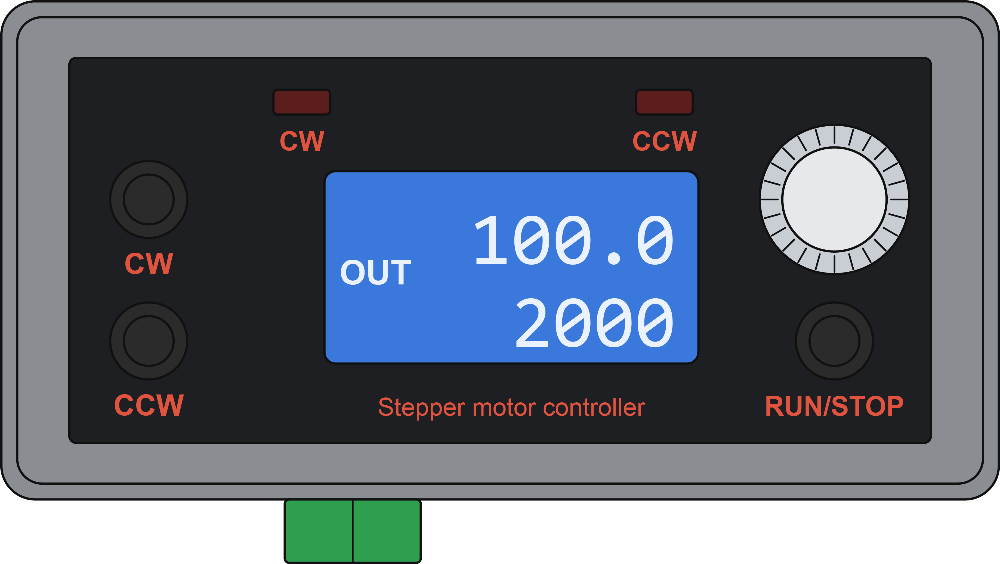
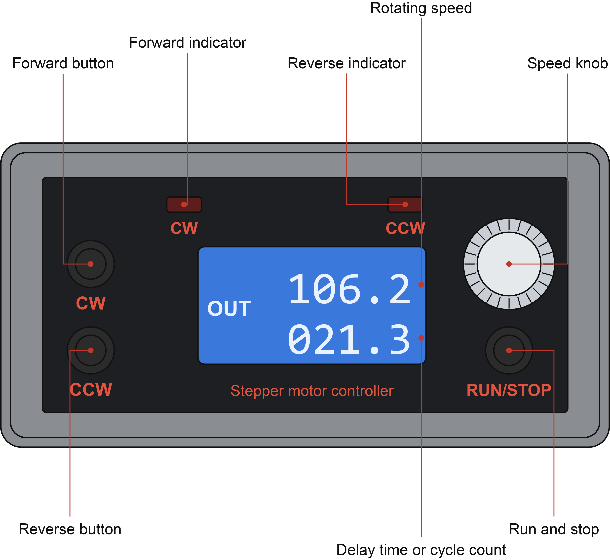
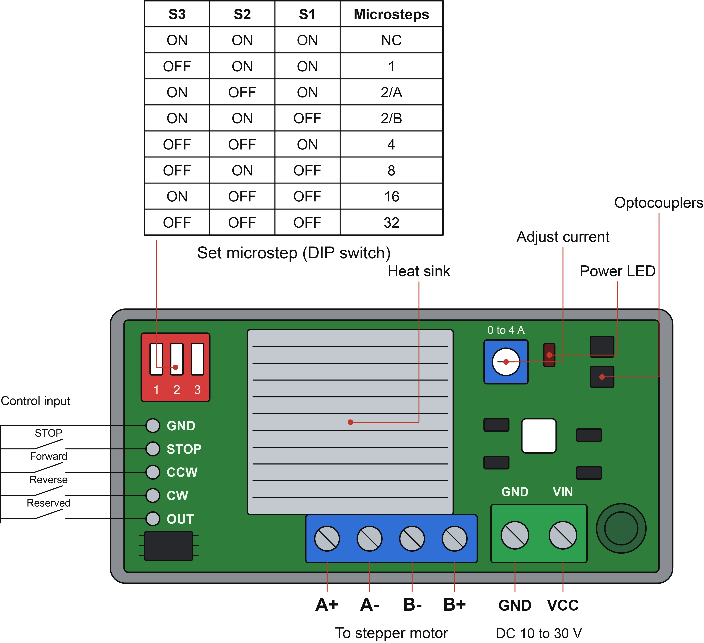
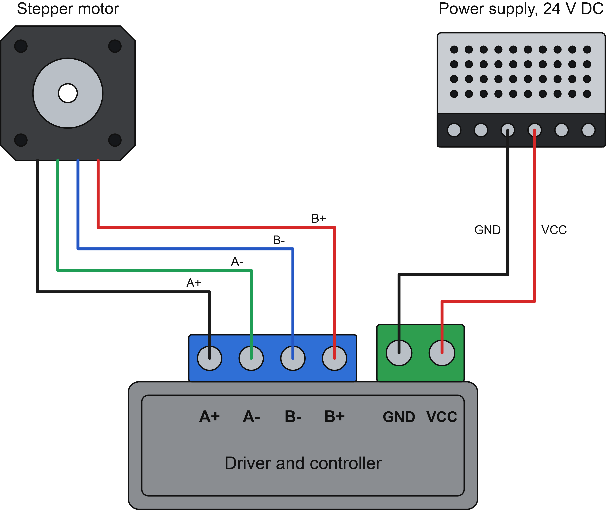
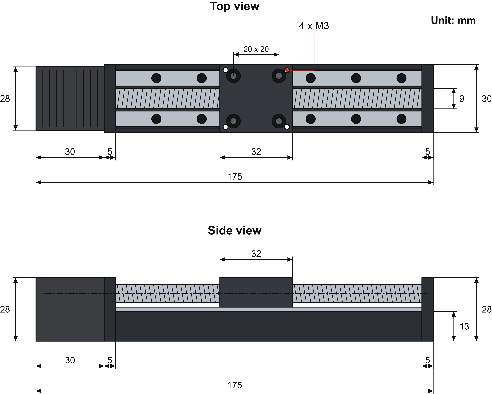
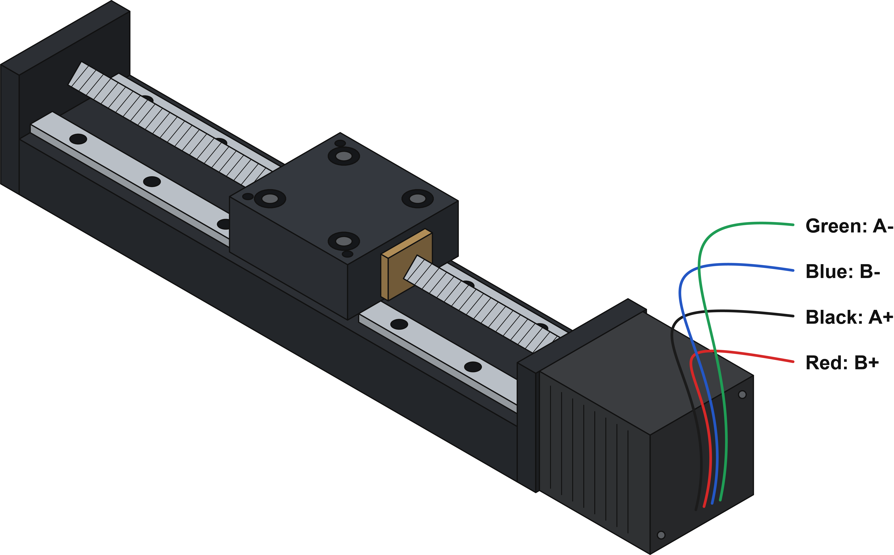

# Motorized manipulator: schematics

Schematics of the linear stage and of the stepper motor driver and controller. Click a picture to open it at full size.

Back to the [Motorized manipulator README](../README.md).

<table>
<tr>
<td width="50%" align="center" valign="top"> <code>driver_1.png</code> Front panel of the driver and controller</td>
<td width="50%" align="center" valign="top"> <code>driver_2.png</code> Front panel with every button, indicator and the speed knob labelled</td>
</tr>
<tr>
<td width="50%" align="center" valign="top"> <code>driver_3.png</code> Driver board: microstep DIP switch table, current adjustment, control inputs, motor and power terminals</td>
<td width="50%" align="center" valign="top"> <code>driver_4.png</code> Wiring of the stepper motor and the 24 V supply to the driver</td>
</tr>
<tr>
<td width="50%" align="center" valign="top"> <code>track_1.png</code> Linear stage, top and side view with dimensions in mm</td>
<td width="50%" align="center" valign="top"> <code>track_2.png</code> Linear stage with the stepper motor lead colors</td>
</tr>
</table>
