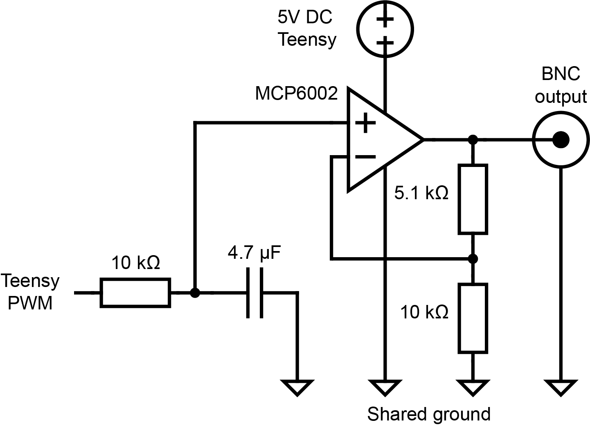

# Optogenetics power modulator

Small circuit that turns the PWM output of the Teensy into a smooth 0 to 5 V analog voltage. This lets
the SPOUT state machine set the light power on every trial, instead of only switching the light on or off.

  

## At a glance

| | |
|---|---|
| Function | 3.3 V PWM in, 0 to 5 V analog command out, for an LED driver or an AOM driver |
| Fabrication | Hand built on a SparkFun Solderable Breadboard Mini, 3D printed housing |
| Approximate cost | 25 USD |
| Used by | SPOUT1 and SPOUT2 |

## How it works

1. Teensy pin 9 outputs an 8 bit PWM signal (0 to 3.3 V). The duty cycle is set by the GUI for each trial.
2. A 10 kOhm resistor and a 4.7 uF capacitor filter the PWM into a DC voltage (time constant 47 ms).
3. An MCP6002 op amp, powered from 5 V, amplifies this voltage with a gain of 1 + 5.1 kOhm / 10 kOhm = 1.51, so 3.3 V in gives about 5 V out.
4. The output goes by BNC to the analog modulation input of the LED driver or the AOM driver.

Because of the filter, a new power level needs about 0.2 s to settle. Set the power before the light
turns on, or use continuous modulation (see below). The 8 bit PWM gives 256 power steps.

## Files

| File | What it is |
|---|---|
| [`circuit/files/opto_power_mod.png`](circuit/files/opto_power_mod.png) | Circuit diagram |
| [`circuit/pictures`](circuit/pictures/) | Photos of the built circuit |
| [`3d_printing/files/housing_opto_power_mod.stl`](3d_printing/files/housing_opto_power_mod.stl) | Housing, 50 x 54 x 22 mm |
| [`3d_printing/pictures`](3d_printing/pictures/) | Render of the housing |

## Bill of materials

| Qty | Part | Notes |
|---|---|---|
| 1 | SparkFun Solderable Breadboard Mini | Carrier for the circuit |
| 1 | MCP6002 dual op amp | One channel used |
| 1 | Resistor 10 kOhm | Filter |
| 1 | Capacitor 4.7 uF | Filter |
| 1 | Resistor 10 kOhm | Gain |
| 1 | Resistor 5.1 kOhm | Gain |
| 1 | Panel BNC connector | Output |
| | Wire | From Teensy pin 9, 5 V and ground |
| 1 | 3D printed housing | |

Total about 25 USD. Full list: [`SPOUT_BOM.xlsx`](../SPOUT_BOM.xlsx).

## Assembly

1. Solder the circuit on the breadboard following the circuit diagram.
2. Connect the input to Teensy pin 9, the op amp supply to 5 V, and ground to the Teensy ground.
3. Wire the output to the panel BNC and mount everything in the printed housing (Prusa MK3, PLA, standard settings).
4. Connect the BNC to the analog modulation input of your LED driver or AOM driver.

Photos of the build process will be added.

## Connecting to SPOUT

* **Input:** Teensy pin 9 (`OptoModPin` in the firmware).
* **On and off:** the light is gated by the optogenetics TTL on pin 40 (`OptoPin`).
* **GUI setting:** choose continuous modulation for an AOM (the analog level stays on, the AOM gates the light), or gated modulation for an LED driver or a laser with analog input. SPOUT was used with LED drivers and with an AA Opto Electronic MTS110 A3 VIS AOM.

## Calibration

Before each session, measure the light power at the fiber tip with a power meter (for example
Thorlabs PM100D with an S120C sensor) at several GUI power settings, and use these values to set the
power in mW.

## License
**CERN-OHL-S-2.0** ([`LICENSE`](../LICENSE)).
