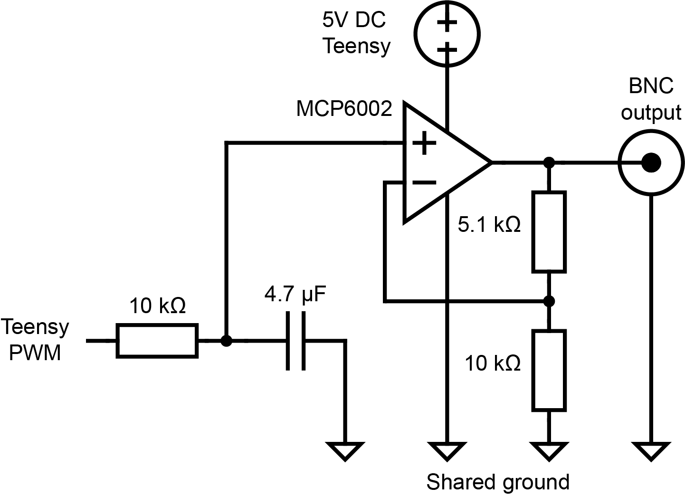

# Optogenetics power modulator: circuit diagram

Circuit diagram. Click a picture to open it at full size.

Back to the [Optogenetics power modulator README](../../README.md).

<table>
<tr>
<td width="50%" align="center" valign="top"> <code>opto_power_mod.png</code> Circuit: Teensy PWM, RC filter, MCP6002 amplifier, BNC output</td>
<td width="50%"></td>
</tr>
</table>
