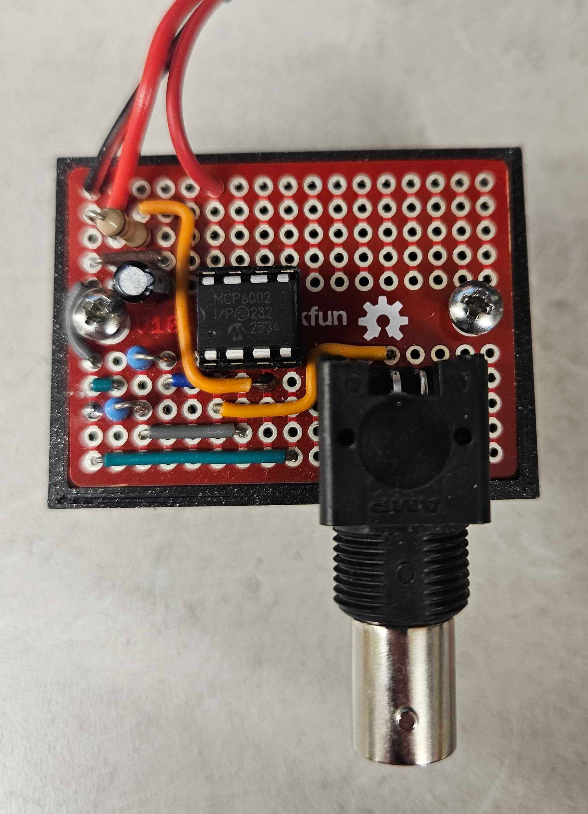
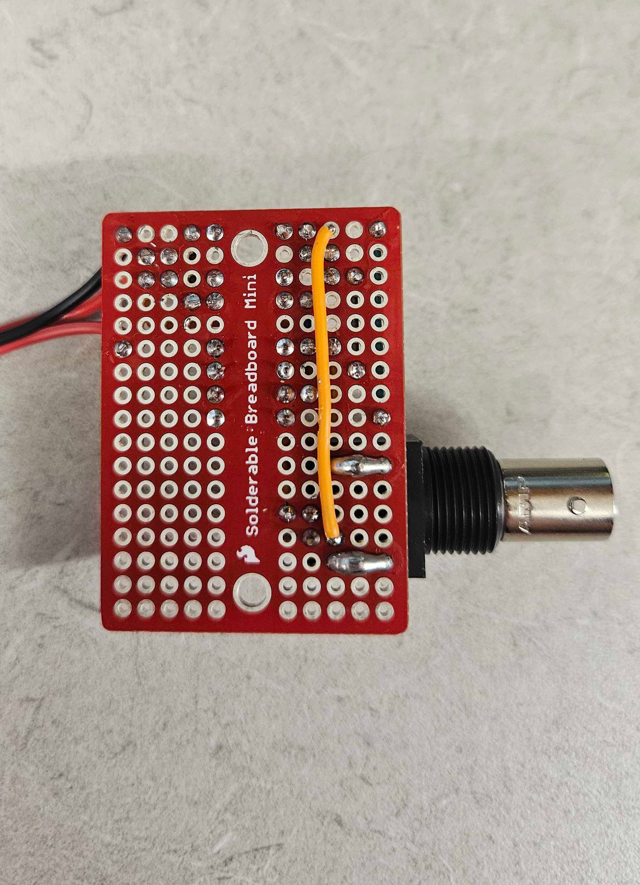
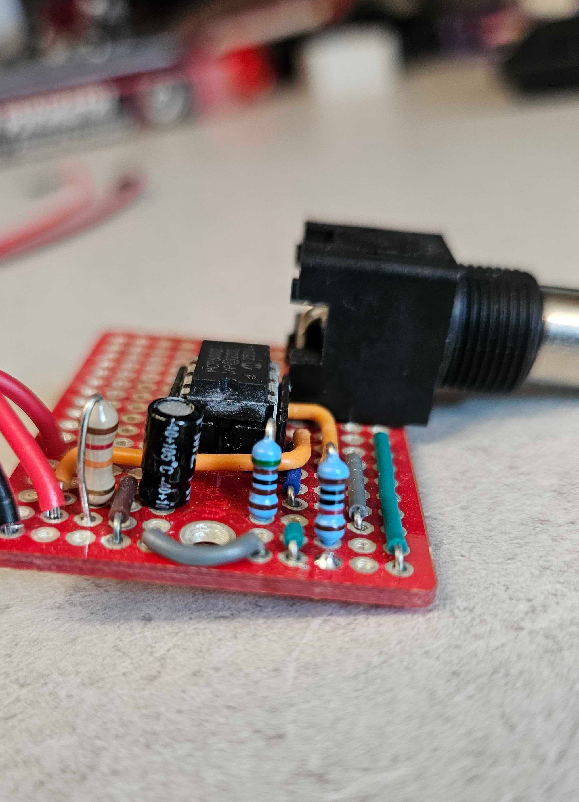
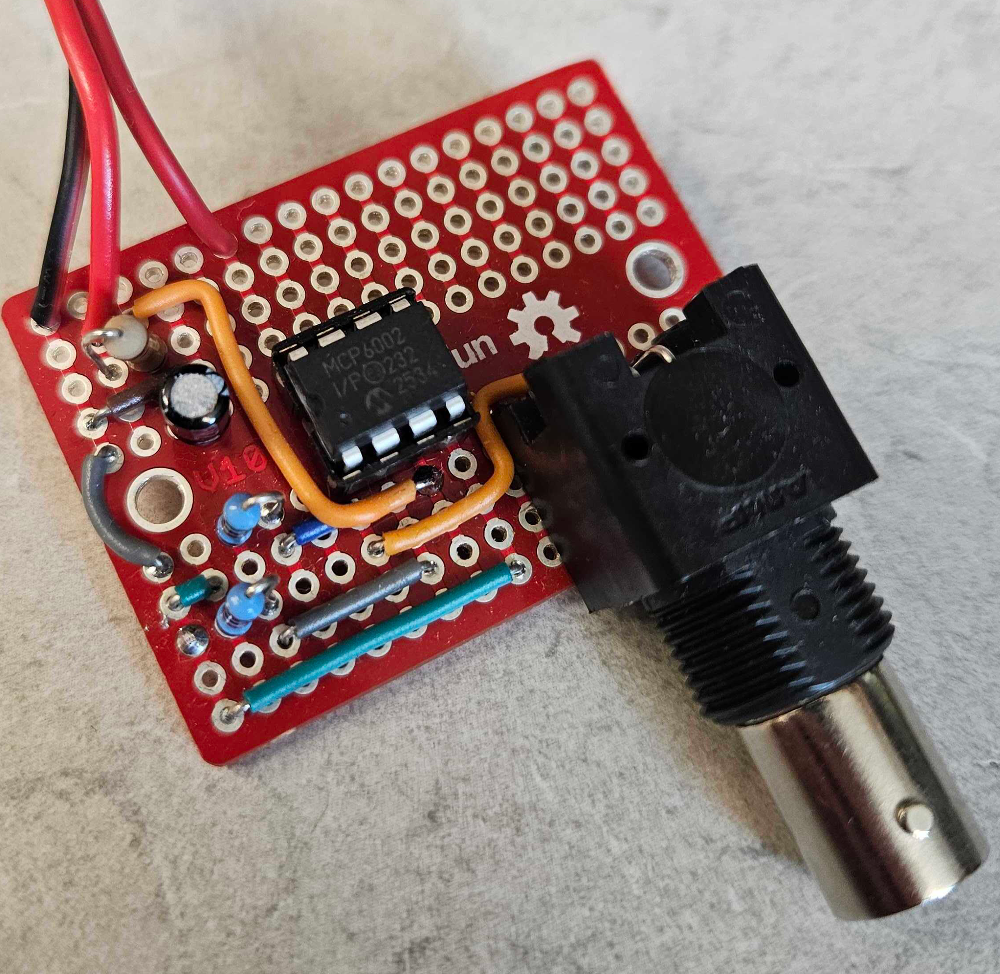

# Optogenetics power modulator: circuit pictures

Photos of the circuit built on a SparkFun Solderable Breadboard Mini. Click a picture to open it at full size.

Back to the [Optogenetics power modulator README](../../README.md).

<table>
<tr>
<td width="50%" align="center" valign="top"> <code>opto_power_mod1.png</code> Circuit in the 3D printed housing, top view</td>
<td width="50%" align="center" valign="top"> <code>opto_power_mod2.png</code> Circuit, bottom view</td>
</tr>
<tr>
<td width="50%" align="center" valign="top"> <code>opto_power_mod3.png</code> Circuit, side view</td>
<td width="50%" align="center" valign="top"> <code>opto_power_mod4.png</code> Circuit with BNC connector, angled view</td>
</tr>
</table>
