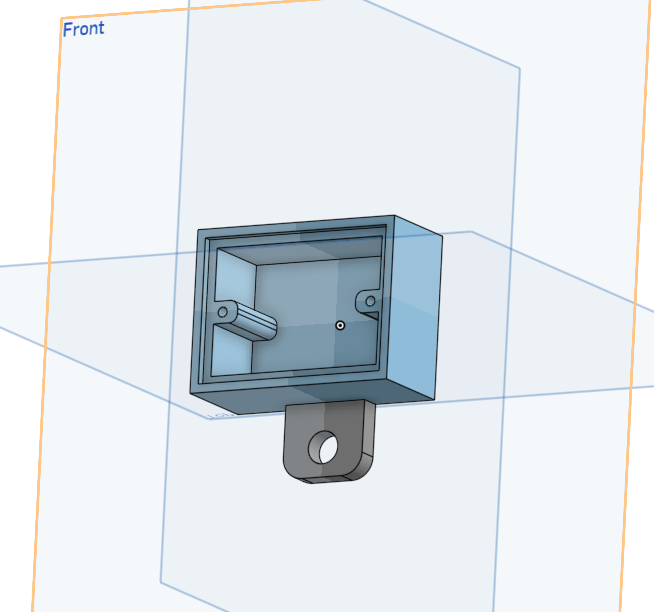

# Optogenetics power modulator: design pictures

Render of the 3D printed housing. Click a picture to open it at full size.

Back to the [Optogenetics power modulator README](../../README.md).

<table>
<tr>
<td width="50%" align="center" valign="top"> <code>housing_opto_power_mod.png</code> Housing, 50 x 54 x 22 mm</td>
<td width="50%"></td>
</tr>
</table>
