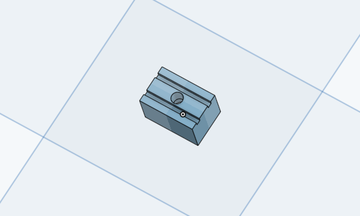
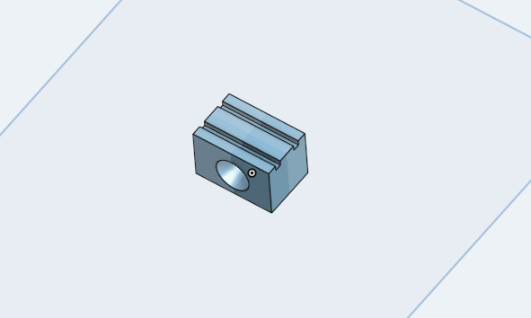
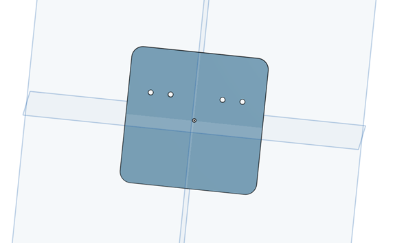

# Spout holder

Small printed blocks that hold the stainless steel lick spout(s) and attach them to an optical post on
the motorized manipulator, and a laser cut plate that holds the two solenoid valves of the water line.

  
  
  

## At a glance

| | |
|---|---|
| Function | Holds one or two lick spouts in front of the mouse, and the two solenoid valves |
| Fabrication | Spout holders 3D printed (Prusa MK3, PLA, standard settings); solenoid holder laser cut from 1/8 inch acrylic |
| Used by | SPOUT1 and SPOUT2 (bottom mount); side mount for tight setups |

## Files

All design files are in [`design/files`](design/files/) and renders in [`design/pictures`](design/pictures/).

| Part | Files | What it is | How we made it |
|---|---|---|---|
| Bottom mount spout holder | [`water_spout_bottom_mount.stl`](design/files/water_spout_bottom_mount.stl) | Holder mounted from below; used on SPOUT1 and SPOUT2 rigs | 3D printed, PLA |
| Side mount spout holder | [`water_spout_side_mount.stl`](design/files/water_spout_side_mount.stl) | Holder mounted from the side, for setups with little space | 3D printed, PLA |
| Dual solenoid holder | [`.dxf`](design/files/dual_solenoid_holder.dxf), [`.stl`](design/files/dual_solenoid_holder.stl), [`.step`](design/files/dual_solenoid_holder.step) | Plate that holds the two solenoid valves | Laser cut, 1/8 inch acrylic |

The solenoid holder can also be 3D printed from the STL file. The STEP file is for editing in CAD.

## Bill of materials (water delivery)

| Qty | Part | Supplier | Part number | Price (USD) |
|---|---|---|---|---|
| 1 | 3D printed spout holder | | | |
| 1 | Stainless steel tube for the spouts | McMaster-Carr | 5560K72 | 3.90 |
| 2 | Syringe 30 ml (water reservoir) | BD Medical | 302832 | 0.32 each |
| 2 | Syringe 5 ml (flushing) | BD Medical | 309646 | 0.18 each |
| 2 | 3 way valve | Cole Parmer | 48523-38 | 1.01 each |
| 2 | Solenoid valve, 5 V | The Lee Company | LHQA0531220H | 65.60 each |
| 10 | Tubing, ID 1/16 inch, OD 1/8 inch | Tygon | E-3603 | 0.28 each |
| 1 | Pedestal post holder | Thorlabs | PH1 | 8.74 |
| 1 | Optical post | Thorlabs | TR6 | 8.66 |
| 2 | Cage rods | Thorlabs | ER3-P4 | 7.26 each |
| 1 | Swivel post | Thorlabs | MSWC | 40.80 |
| 1 | Dual solenoid holder, laser cut 1/8 inch acrylic | | | |

Full list: [`SPOUT_BOM.xlsx`](../SPOUT_BOM.xlsx).

## Assembly

1. Cut the stainless steel tube to length for the spout(s) and deburr the ends.
2. Press fit the spout(s) into the holder and secure with a little glue.
3. Mount the holder on an optical post on the [motorized manipulator](../motorized_manipulator/).
4. Mount the two solenoids on the dual solenoid holder.
5. Connect each spout with Tygon tubing to its solenoid, and the solenoid to the 30 ml reservoir syringe through a 3 way valve. The 5 ml syringe on the valve is used to flush the line.
6. Connect each spout to the [dual lick detector](../dual_lick_detector/) and each solenoid to the [Teensy breakout board](../teensy_breakout_board/).

Photos of the build process will be added.

## License
**CERN-OHL-S-2.0** ([`LICENSE`](../LICENSE)).
