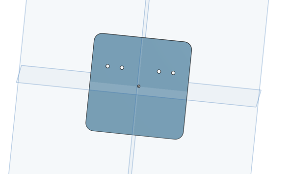
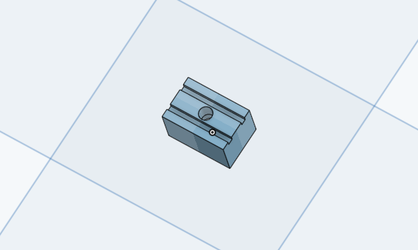
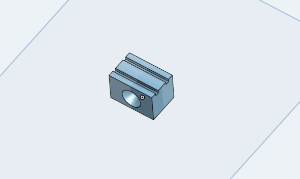

# Spout holder: design pictures

Renders of the spout holders and the dual solenoid holder. Click a picture to open it at full size.

Back to the [Spout holder README](../../README.md).

<table>
<tr>
<td width="50%" align="center" valign="top"> <code>dual_solenoid_holder.png</code> Dual solenoid holder</td>
<td width="50%" align="center" valign="top"> <code>water_spout_bottom_mount.png</code> Spout holder, bottom mount</td>
</tr>
<tr>
<td width="50%" align="center" valign="top"> <code>water_spout_side_mount.png</code> Spout holder, side mount</td>
<td width="50%"></td>
</tr>
</table>
