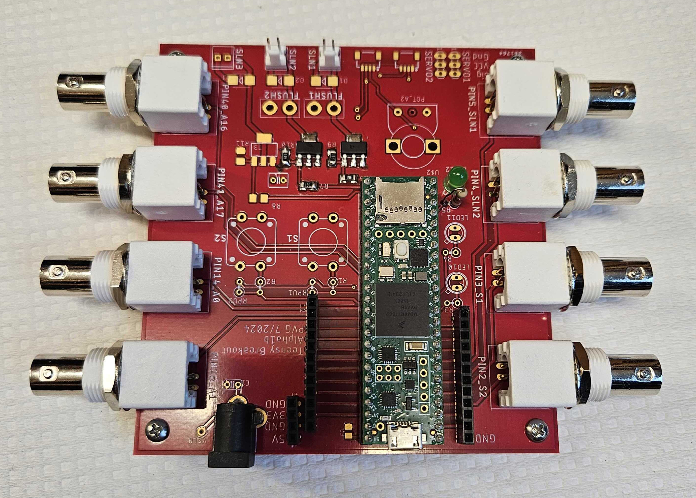
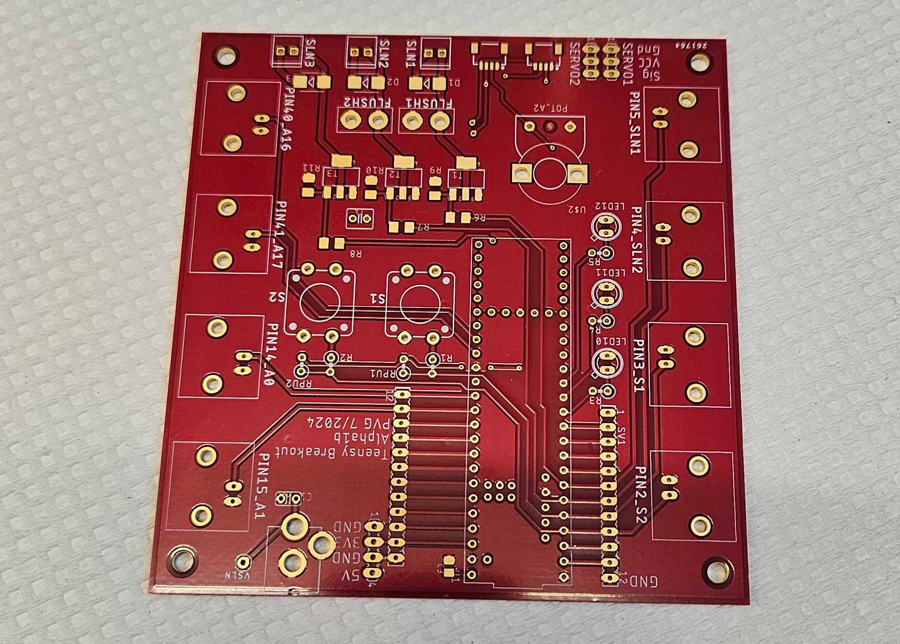
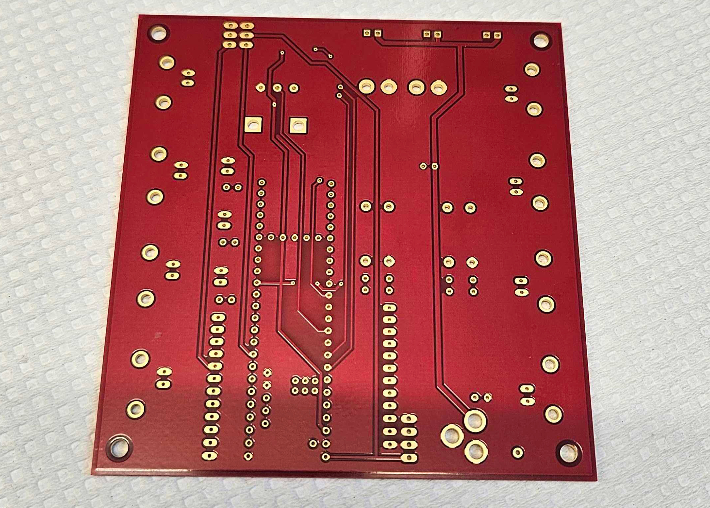
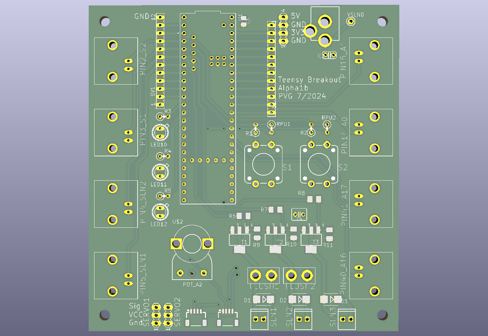
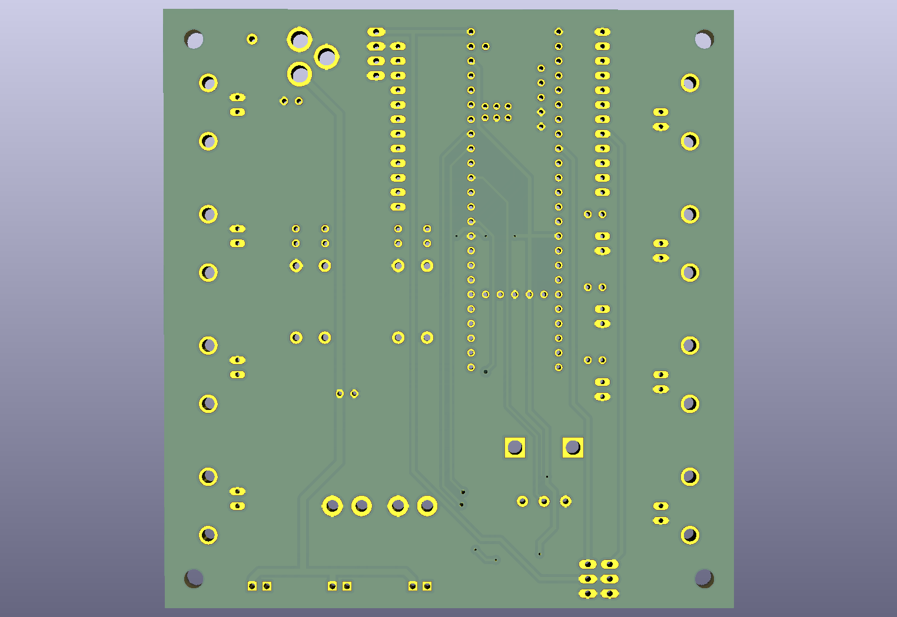

# Teensy breakout board: PCB pictures

Photos and KiCad renders of the board, revision Alpha1b. Click a picture to open it at full size.

Back to the [Teensy breakout board README](../../README.md).

<table>
<tr>
<td width="50%" align="center" valign="top"> <code>Teensy_breakout_board_1.jpg</code> Assembled board with the Teensy 4.1 and eight BNC connectors</td>
<td width="50%" align="center" valign="top"> <code>Teensy_breakout_board_2.jpg</code> Bare board, top</td>
</tr>
<tr>
<td width="50%" align="center" valign="top"> <code>Teensy_breakout_board_3.jpg</code> Bare board, bottom</td>
<td width="50%" align="center" valign="top"> <code>Teensy_breakout_board_schematic_1.png</code> KiCad render, top</td>
</tr>
<tr>
<td width="50%" align="center" valign="top"> <code>Teensy_breakout_board_schematic_2.png</code> KiCad render, bottom</td>
<td width="50%"></td>
</tr>
</table>
