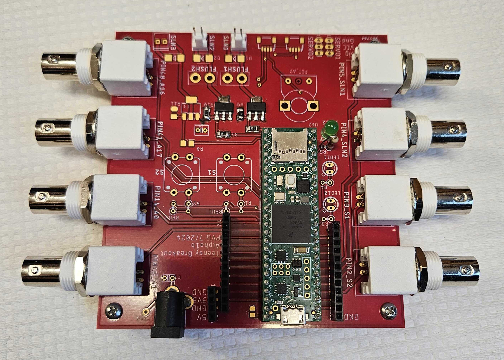
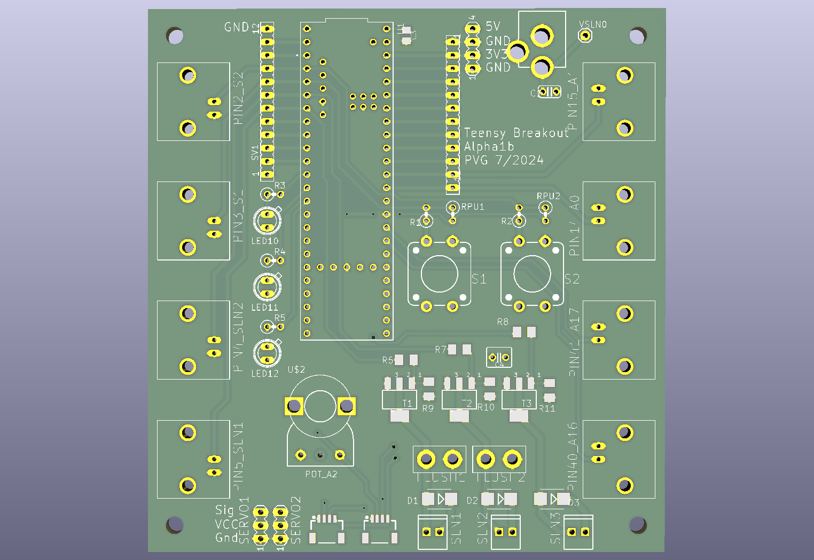

# Teensy breakout board

The heart of a SPOUT rig. This board carries the Teensy 4.1 that runs the SPOUT state machine,
drives the water solenoids, and brings every input and output to a BNC connector or a header.

  
  

## At a glance

| | |
|---|---|
| Function | Teensy 4.1 carrier with solenoid drivers and BNC inputs and outputs |
| Design | Pavel Gorelik, HMS Research Instrumentation Core, revision Alpha1b (KiCad 10) |
| Fabrication | PCB, Teensy in a socket, 3D printed housing |
| Approximate cost | 100 USD for the assembled board |
| Used by | SPOUT1 and SPOUT2 |

## Files

| File | What it is |
|---|---|
| [`PCB/files/Teensy_breakout_board.kicad_sch`](PCB/files/Teensy_breakout_board.kicad_sch) | Schematic (KiCad 10) |
| [`PCB/files/Teensy_breakout_board.kicad_pcb`](PCB/files/Teensy_breakout_board.kicad_pcb) | Board layout (KiCad 10) |
| [`PCB/pictures`](PCB/pictures/) | Photos and board renders, see below |

| Part | Files | What it is | How we made it |
|---|---|---|---|
| Housing | [`.stl`](design/files/box_teensy_breakoutboard.stl), [`.step`](design/files/box_teensy_breakoutboard.step) | Housing, 152 x 106 x 20 mm | 3D printed, PLA |

The SPOUT paper used revision Alpha1b (KiCad 10), the version in this folder.
Newer revisions are developed in the [HMS RIC repository](https://github.com/HMS-RIC/Teensy-Breakout-general-purpose).

### Pictures

| Picture | What it shows |
|---|---|
| [`Teensy_breakout_board_1.jpg`](PCB/pictures/Teensy_breakout_board_1.jpg) | Assembled board with the Teensy 4.1 and eight BNC connectors |
| [`Teensy_breakout_board_2.jpg`](PCB/pictures/Teensy_breakout_board_2.jpg) | Bare board, top |
| [`Teensy_breakout_board_3.jpg`](PCB/pictures/Teensy_breakout_board_3.jpg) | Bare board, bottom |
| [`Teensy_breakout_board_schematic_1.png`](PCB/pictures/Teensy_breakout_board_schematic_1.png) | Board render from KiCad, top |
| [`Teensy_breakout_board_schematic_2.png`](PCB/pictures/Teensy_breakout_board_schematic_2.png) | Board render from KiCad, bottom |

## Bill of materials

| Qty | Part | Supplier | Part number | Price (USD) |
|---|---|---|---|---|
| 1 | Assembled breakout board including Teensy 4.1 | | | 100 |
| 1 | 3D printed housing | | | |
| 1 | Power adapter 5 V for the solenoids | MTYTOT | ALT-0503 | 6.99 |
| 2 | Solenoid valve, 5 V | The Lee Company | LHQA0531220H | 65.60 each |
| 5 | BNC cable, 50 Ohm, 3 feet | | | 5.63 each |

Full list: [`SPOUT_BOM.xlsx`](../SPOUT_BOM.xlsx).

## Ordering the PCB

The board is designed in KiCad 10. Open the `.kicad_pcb` file in KiCad (free, [kicad.org](https://www.kicad.org)) and export
what your fabricator needs: Gerber and drill files (File, Fabrication Outputs), and for commercial assembly the
component list and the position file from the same menu. Default manufacturing settings are fine.

## Fabrication

1. **PCB.** Order the board as described above.
2. **Teensy.** Solder female headers on the board and male headers on the Teensy 4.1, so the Teensy can be swapped.
3. **Housing.** Print `box_teensy_breakoutboard.stl` on a Prusa MK3 in PLA with standard settings. Mount the board with 4-40 screws and the housing on the breadboard with 1/4 20 screws.

## Assembly

1. Insert the Teensy 4.1 in its socket.
2. Connect the 5 V adapter to the solenoid supply input. The Teensy itself is powered over USB from the computer, so the solenoid supply and the Teensy supply stay separate.
3. Make the connections listed below for SPOUT1 or SPOUT2.
4. Connect the remaining TTL outputs you need (see the pin map) from the headers to your acquisition system.
5. Connect the Teensy to the computer by USB and flash the firmware (see [software](https://github.com/spout-task/software)).

## Connections

The BNC connectors are labelled on the board with the Teensy pin and their function.

**SPOUT1**

| Board connector | Connect to |
|---|---|
| PIN2_S2 | Tone (amplifier input) |
| PIN3_S1 | Sync pulse (to your acquisition system) |
| PIN5_SLN1 | TTL of the solenoid command |
| PIN14_A0 | Lick (from the lick detector output) |
| PIN40_A16 | Optogenetics driver |
| SLN1 | Solenoid |

**SPOUT2**

| Board connector | Connect to |
|---|---|
| PIN2_S2 | Left tone (amplifier input) |
| PIN15_A1 | Right tone (amplifier input) |
| PIN3_S1 | Sync pulse (to your acquisition system) |
| PIN5_SLN1 | TTL of the left solenoid command |
| PIN4_SLN2 | TTL of the right solenoid command |
| PIN14_A0 | Left lick (from the lick detector) |
| PIN41_A17 | Right lick (from the lick detector) |
| PIN40_A16 | Optogenetics driver |
| SLN1 | Left solenoid |
| SLN2 | Right solenoid |

Photos of the build process will be added.

## Pin map

Which Teensy pin is on which connector of the board (revision Alpha1b), and what SPOUT uses it for.
The firmware options for every pin are explained in the software READMEs for
[SPOUT1](https://github.com/spout-task/software/tree/main/SPOUT1) and
[SPOUT2](https://github.com/spout-task/software/tree/main/SPOUT2).

| Teensy pin | Board connector | SPOUT2 (two spouts) | SPOUT1 (one spout) |
|---|---|---|---|
| 2 | BNC PIN2_S2, header SV1 | Left speaker | Speaker A |
| 3 | BNC PIN3_S1, header SV1 | Sync pulse output (pseudo random) | Sync pulse output |
| 4 | BNC PIN4_SLN2, solenoid driver SLN2, header SV1 | Right solenoid | Not used |
| 5 | BNC PIN5_SLN1, solenoid driver SLN1, header SV1 | Left solenoid | Solenoid |
| 14 (A0) | BNC PIN14_A0, header SV2 | Left lick input | Lick input |
| 15 (A1) | BNC PIN15_A1, header SV2 | Right speaker | Speaker B (optional) |
| 40 (A16) | BNC PIN40_A16 | Optogenetics TTL | Optogenetics TTL |
| 41 (A17) | BNC PIN41_A17 | Right lick input | Not used |
| 1 | Header SV1 | Optogenetics copy (reporter LED) | Optogenetics copy |
| 6 | Header SV1, SERVO1 | Speaker TTL | Speaker TTL |
| 7 | Header SV1, SERVO2 | Trial start TTL | Trial start TTL |
| 8 | Header SV1 | ITI TTL | ITI TTL |
| 9 | Header SV1 | Optogenetics power modulation (PWM) | Optogenetics power modulation (PWM) |
| 10 | Board LED10 | Session start and stop pulse | Session start and stop pulse |
| 11 | Board LED11 | Camera trigger (2 ms pulses at 50 Hz) | Off |
| 12 | Board LED12 | External sync report | External sync report |
| 13 | SLN3 position (driver not fitted) | Error light | Off |
| 16 (A2) | Header SV2, potentiometer | Start cue TTL | Not used |
| 17 (A3) | Header SV2 | Left cue TTL | Cue A TTL |
| 18 (A4) | Header SV2, Qwiic SDA | Right cue TTL | Cue B TTL |
| 19 (A5) | Header SV2, Qwiic SCL | Left reward TTL | Reward TTL |
| 20 (A6) | Header SV2 | Right reward TTL | Not used |
| 21 (A7) | Header SV2 | Random background light | Random background light |
| 22 (A8) | Header SV2 | External sync input (3.3 V maximum) | External sync input (3.3 V maximum) |
| 23 (A9) | Header SV2 | Start cue speaker | Not used |
| 24 | Teensy pin only | Delay TTL (delayed response task) | Not used |
| 37, 38, 39 | Teensy pins only | Optional hardware buttons | Off |

Header SV1 carries pins 0 to 9, header SV2 carries pins 14 to 23, and header SV4 carries 3.3 V,
VCC and ground. Pins marked "Teensy pin only" are not on a header of this revision; solder a wire to
the Teensy if you need them. All signals are 3.3 V logic. The Teensy 4.1 is not 5 V tolerant, so never
connect a 5 V signal to an input.

## Expansion options

The board has more on it than SPOUT uses. These parts are free for your own extensions:

* **Third solenoid driver (SLN3).** Pin 13 has a place for a third driver, not fitted on the SPOUT boards. Fit the MOSFET (T3), the flyback diode (D3) and the two resistors (R8, R11) with the same parts as SLN1 and SLN2 to switch a third valve, or a 5 V light such as the SPOUT2 error light.
* **Manual flush.** Headers FLUSH1 and FLUSH2 sit across the SLN1 and SLN2 drivers. A push button on a FLUSH header is meant to open that valve without the Teensy, for example to fill or rinse the lines.
* **Push buttons S1 and S2.** On pins 3 and 2, with pull up resistors. SPOUT uses these pins as sync and speaker outputs, so use the buttons only with firmware that does not.
* **Servo headers SERVO1 and SERVO2.** Signal on pins 6 and 7, powered from VCC. SPOUT uses pins 6 and 7 as TTL outputs.
* **Potentiometer.** On pin 16 (A2), between 3.3 V and ground, for example to set a parameter by hand.
* **Qwiic connectors J1 and J6.** I2C on pins 18 (SDA) and 19 (SCL) for Qwiic sensors. SPOUT uses these pins as TTL outputs, and you should check the connector pinout against the schematic before plugging in a Qwiic device.
* **Indicator LEDs.** LED10, LED11 and LED12 light up with pins 10, 11 and 12.
* **Free pins.** Pin 0 (header SV1) is free in both firmwares; SPOUT1 also leaves pins 11, 13, 16, 23 and 24 free.

SPOUT does not use the Qwiic, servo, potentiometer, push button or FLUSH connectors.

## Testing

1. Open the GUI and give a manual reward: the solenoid clicks and the reward TTL goes high.
2. Touch a spout while the mouse ground is connected: the lick appears in the GUI.
3. Start a session and check the sync pulses on pin 3 with your acquisition system.

## License and attribution
Designed by Pavel Gorelik of the [HMS Research Instrumentation Core](https://github.com/HMS-RIC), whose
members are authors of SPOUT, and shared here as part of SPOUT under **CERN-OHL-S-2.0**
([`LICENSE`](../LICENSE)). Newer revisions are developed in the
[HMS RIC repository](https://github.com/HMS-RIC/Teensy-Breakout-general-purpose).
