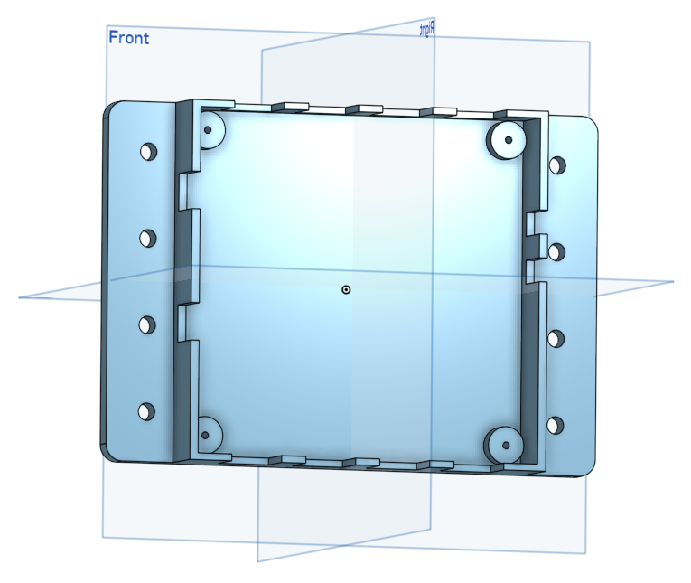

# Teensy breakout board: design pictures

Render of the 3D printed housing. Click a picture to open it at full size.

Back to the [Teensy breakout board README](../../README.md).

<table>
<tr>
<td width="50%" align="center" valign="top"> <code>box_teensy_breakoutboard.png</code> Housing, 152 x 106 x 20 mm</td>
<td width="50%"></td>
</tr>
</table>
